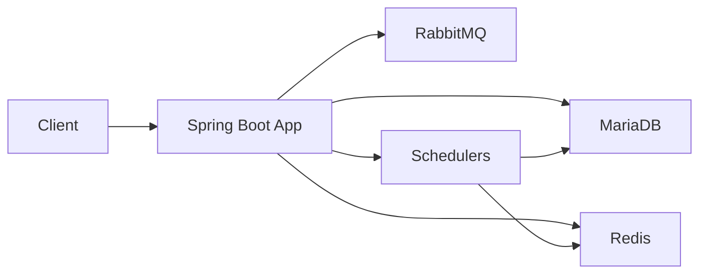
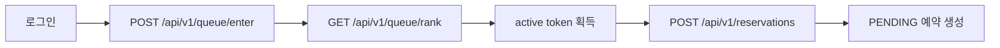
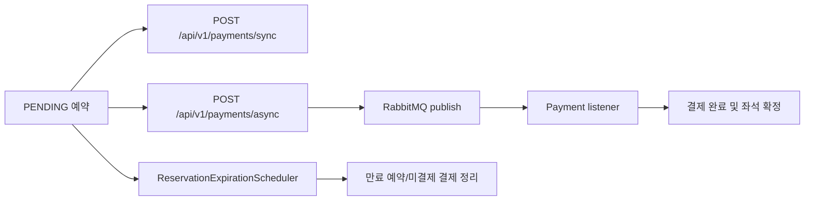

# Ticketing - 대기열 기반 콘서트 예매 시스템

`ticketing`은 콘서트 예매에서 발생하는 **오픈 시간 대기열 진입, 좌석 선점, 예약 확정, 동기/비동기 결제** 흐름을 다루는 프로젝트입니다.

사용자는 대기열에 진입한 뒤 active 상태를 획득해야 예약을 진행할 수 있고, 좌석은 락 전략을 통해 중복 예약을 방지합니다. 결제는 동기 처리와 RabbitMQ 기반 비동기 처리를 모두 제공하며, 예약 만료 스케줄러가 미결제 예약과 임시 선점 좌석을 복구합니다.

핵심 엔드포인트는 다음 코드에서 확인할 수 있습니다.

- Queue: [QueueController](./src/main/java/com/ticketing/api/queue/controller/QueueController.java)
- Reservation: [ReservationController](./src/main/java/com/ticketing/api/reservation/controller/ReservationController.java)
- Payment: [PaymentController](./src/main/java/com/ticketing/api/payment/controller/PaymentController.java)

## 프로젝트 목표

- 대기열 기반으로 예약 오픈 트래픽을 제어합니다.
- 좌석 예약의 정합성을 보장하고 중복 예약을 방지합니다.
- 동기/비동기 결제 흐름을 분리해 처리 안정성을 확보합니다.
- k6 기반 부하테스트로 병목과 tail latency를 검증합니다.

## 포트폴리오 핵심 포인트

- **대기열 제어**: Redis 기반 waiting/active 상태로 예매 진입량을 제한합니다.
- **좌석 정합성**: Redisson 분산락과 비관적 락 경로를 비교할 수 있도록 구성했습니다.
- **빠른 실패 전략**: 예약 불가 좌석 캐시와 lock wait timeout으로 경합 실패 응답을 분리합니다.
- **비동기 결제**: RabbitMQ 메시징으로 결제 요청 접수와 후속 처리를 분리합니다.
- **성능 검증**: k6, slow query, Actuator 지표로 병목 후보를 나누어 관측했습니다.

## Git Flow

- `master`: 배포 기준 브랜치
- `develop`: 통합 개발 브랜치
- `feature/*`: 기능 개발 브랜치
- `hotfix/*`: 운영 이슈 대응 브랜치

현재 작업 흐름은 `develop + feature/*` 중심으로 운영하는 것을 기본 가정으로 합니다.

## 프로젝트 기술 스택

- Java 17: 애플리케이션 런타임
- Spring Boot 3.5: 웹 애플리케이션, 보안, 스케줄링, 메시징
- MyBatis: SQL 기반 영속성 계층
- MariaDB 10.6: 예약/결제/회원/좌석 데이터 영속화
- Redis 7: 대기열, 세션, 스케줄 메타 관리
- RabbitMQ 3.13: 비동기 결제 메시징
- Docker Compose: 로컬 실행 환경 구성
- k6: queue/reservation 성능 검증

## 서비스 아키텍처



- Spring Boot 애플리케이션은 예약, 결제, 대기열, 인증 흐름을 처리합니다.
- MariaDB는 예약/결제/좌석 상태를 영속화합니다.
- Redis는 대기열 순번, active 토큰, 세션, 스케줄 메타를 담당합니다.
- RabbitMQ는 비동기 결제 요청을 소비 가능한 메시지로 분리합니다.
- 스케줄러는 queue 활성화와 예약 만료 복구를 담당합니다.

Docker 실행 기준 구성은 [docker-compose.yml](./docker-compose.yml) 에 정의되어 있습니다.

## 핵심 기능 Flow

### 대기열/예약 Flow



- 대기열 진입과 순번 조회는 [QueueService](./src/main/java/com/ticketing/application/queue/service/QueueService.java) 가 처리합니다.
- 예약 생성은 active 토큰 검증을 통과해야 하며, 이 검증은 [QueueValidationAspect](./src/main/java/com/ticketing/global/aop/QueueValidationAspect.java) 에서 수행됩니다.
- 좌석 예약은 락 전략에 따라 처리되며, 분산락 경로의 진입점은 [DistributedLockReservationFacade](./src/main/java/com/ticketing/application/reservation/facade/DistributedLockReservationFacade.java) 입니다.

### 결제/복구 Flow



- 동기 결제는 요청 트랜잭션 안에서 바로 결제를 완료합니다.
- 비동기 결제는 [PaymentService](./src/main/java/com/ticketing/application/payment/service/PaymentService.java) 가 payment를 `PENDING` 상태로 만들고 이벤트를 발행한 뒤, RabbitMQ listener가 후속 완료를 처리합니다.
- 예약이 만료되면 [ReservationExpirationScheduler](./src/main/java/com/ticketing/application/reservation/scheduler/ReservationExpirationScheduler.java) 가 pending 예약과 미완료 payment를 정리하고 좌석을 해제합니다.

## 핵심 API

| 기능 | 메서드 | 경로 | 설명 |
| --- | --- | --- | --- |
| 대기열 진입 | `POST` | `/api/v1/queue/enter` | schedule 기준 대기열 진입 또는 즉시 입장 |
| 대기열 순번 조회 | `GET` | `/api/v1/queue/rank` | 현재 순번/예상 재시도 시간 조회 |
| active 상태 이탈 | `DELETE` | `/api/v1/queue/active/{scheduleId}` | active 대기열 상태 종료 |
| 예약 생성 | `POST` | `/api/v1/reservations` | active 토큰 보유 사용자만 예약 가능 |
| 예약 목록 조회 | `GET` | `/api/v1/reservations` | 현재 사용자 예약 목록 조회 |
| 동기 결제 | `POST` | `/api/v1/payments/sync` | 결제를 즉시 완료하고 좌석/예약 확정 |
| 비동기 결제 | `POST` | `/api/v1/payments/async` | 결제를 비동기 요청으로 접수 |
| 결제 조회 | `GET` | `/api/v1/payments/{paymentId}` | 결제 상태 조회 |

## 동시성 제어 전략

예매 오픈 시점에는 같은 좌석에 여러 사용자가 동시에 접근할 수 있기 때문에, 좌석 예약은 반드시 동시성 제어가 필요합니다.

- 현재 프로젝트는 `ticketing.lock.strategy` 설정으로 락 전략을 전환할 수 있습니다.
- 분산락 경로와 비관락 경로가 공존하며, 환경과 검증 목적에 따라 전략을 바꿔 비교할 수 있습니다.
- Redis 예약 불가 캐시는 이미 임시 선점되었거나 판매 완료된 좌석에 대해 lock 진입 전 빠른 실패를 유도합니다.

## 로컬 실행 방법

### 일반 실행

- 전체 스택 실행: [docker-compose.yml](./docker-compose.yml)
- 실행 명령:

```bash
docker compose up --build
```

- 최초 기동 시 [schema.sql](./src/main/resources/schema.sql) 이 MariaDB init script로 자동 적용됩니다.
- 스키마를 새로 만들려면 아래 명령으로 volume까지 삭제해야 합니다.
- `root/root`, `guest/guest` 계정은 로컬 Docker Compose 실행용 기본값입니다.

```bash
docker compose down -v
```

### Loadtest 실행

- 부하테스트용 인프라: [docker-compose.loadtest.yml](./docker-compose.loadtest.yml)
- 상세 실행 가이드: [loadtest/README.md](./loadtest/README.md)
- 일반 compose와 loadtest compose를 동시에 사용하면 `3306`, `6379` 포트 충돌이 날 수 있습니다.

## 성능 테스트

- queue burst, rank polling, reservation unique/contention, e2e 시나리오를 분리해 측정했습니다.
- 상세 실행 방법은 [loadtest/README.md](./loadtest/README.md) 에 정리되어 있습니다.
- raw 결과 파일은 Git 추적 대상이 아니며, 저장소에는 Markdown 요약만 남깁니다.

대표 성능 문서는 다음 순서로 읽는 것을 권장합니다.

| 문서 | 목적 |
| --- | --- |
| [예약 시스템 부하테스트 및 성능 개선 요약](./docs/performance/reservation-loadtest-performance-report.md) | 경합 없는 예약 생성 기준선과 Tomcat/Hikari/Redis 병목 관측 |
| [인기 좌석군 경합 부하테스트 결과](./docs/performance/stress-reservation-popular-contention-result.md) | 인기 좌석군 경합에서 중복 예약 방지 검증 |
| [예약 좌석 경합 병목 탐색 결과](./docs/performance/reservation-contention-bottleneck-analysis.md) | 단일 좌석 burst 지연 원인 분석 |
| [예약 빠른 실패 부하테스트 결과](./docs/performance/reservation-fast-fail-loadtest-result.md) | unavailable cache와 lock wait time 튜닝 결과 |
| [Active 사용자 수별 Admission 기준 도출 결과](./docs/performance/active-admission-loadtest-result.md) | active 사용자 수 변화에 따른 안정 구간 확인 |

성능 수치는 로컬 Windows PC와 Docker 기반 loadtest 환경에서 얻은 결과이므로, 운영 환경의 절대 처리량으로 단정하지 않고 조건 변경에 따른 상대 비교 근거로 해석합니다.

## 기본 검증

일반 기능 검증은 다음 명령을 기준으로 합니다.

```bash
./gradlew test
```

부하테스트 smoke는 loadtest 인프라를 준비한 뒤 실행합니다.

```bash
./gradlew loadtestAppBuild
./gradlew loadtestBaseRebuild
./gradlew loadtestRunReset
./gradlew loadtestRunK6 -Pscenario=smoke-seeded-login -Ptargets=loadtest/k6/data/targets.smoke.json
```

## 트러블슈팅 / 개선 포인트

- Payment 비동기 안정성
  - 현재는 RabbitMQ 기반 비동기 결제를 사용하며, outbox, retry, DLQ를 통한 안정성 보강 여지가 있습니다.
- Queue p95 tail latency 해석
  - burst 시나리오는 endpoint 단일 처리시간이 아니라 로그인/CSRF/queue 진입이 섞인 사용자 경험 지표로 읽어야 합니다.
- 스키마 불일치 이슈
  - 로컬 DB가 오래된 상태면 mapper가 기대하는 컬럼과 실제 테이블 구조가 어긋날 수 있습니다. 현재는 `schema.sql` 기반 초기화 방식이며, 운영형 migration 도구는 적용하지 않았습니다.
- Contention 결과 해석
  - 좌석 경쟁 시 `400`은 시스템 오류가 아니라 “정상 경쟁 실패”일 수 있으므로 비즈니스 실패와 예외 실패를 분리해 봐야 합니다.

## 상세 문서

- Loadtest 실행 가이드: [loadtest/README.md](./loadtest/README.md)
- 예약 기준선/성능 개선: [docs/performance/reservation-loadtest-performance-report.md](./docs/performance/reservation-loadtest-performance-report.md)
- 인기 좌석군 경합 검증: [docs/performance/stress-reservation-popular-contention-result.md](./docs/performance/stress-reservation-popular-contention-result.md)
- 단일 좌석 경합 병목 분석: [docs/performance/reservation-contention-bottleneck-analysis.md](./docs/performance/reservation-contention-bottleneck-analysis.md)
- 빠른 실패 전략 검증: [docs/performance/reservation-fast-fail-loadtest-result.md](./docs/performance/reservation-fast-fail-loadtest-result.md)
- Active admission 기준: [docs/performance/active-admission-loadtest-result.md](./docs/performance/active-admission-loadtest-result.md)

## Commit Convention

- `feat`: 새로운 기능 추가
- `fix`: 버그 수정
- `docs`: 문서 수정
- `refactor`: 리팩터링
- `test`: 테스트 코드 추가/수정
- `chore`: 빌드, 설정, 의존성, 기타 작업
