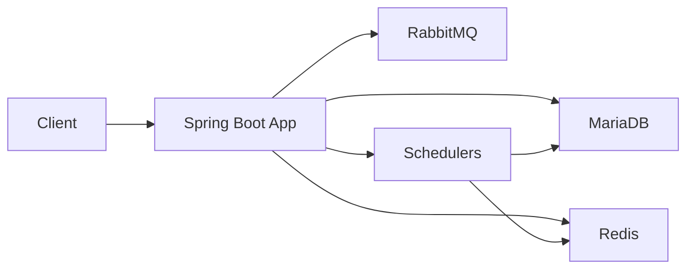
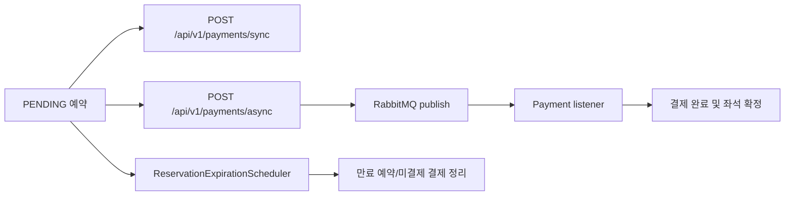

# Ticketing - 대기열 기반 콘서트 예매 시스템

`ticketing`은 콘서트 예매에서 발생하는 **오픈 시간 대기열 진입, 좌석 선점, 예약 확정, 동기/비동기 결제** 흐름을 다루는 프로젝트입니다.

사용자는 대기열에 진입한 뒤 active 상태를 획득해야 예약을 진행할 수 있고, 좌석은 락 전략을 통해 중복 예약을 방지합니다. 결제는 동기 처리와 RabbitMQ 기반 비동기 처리를 모두 제공하며, 예약 만료 스케줄러가 미결제 예약과 임시 선점 좌석을 복구합니다.

핵심 엔드포인트는 다음 코드에서 확인할 수 있습니다.

- Queue: [QueueController](./src/main/java/com/ticketing/api/queue/controller/QueueController.java)
- Reservation: [ReservationController](./src/main/java/com/ticketing/api/reservation/controller/ReservationController.java)
- Payment: [PaymentController](./src/main/java/com/ticketing/api/payment/controller/PaymentController.java)

## 프로젝트 목표

- 대기열 기반으로 예약 오픈 트래픽을 제어합니다.
- 좌석 예약의 정합성을 보장하고 중복 예약을 방지합니다.
- 동기/비동기 결제 흐름을 분리해 처리 안정성을 확보합니다.
- k6 기반 부하테스트로 병목과 tail latency를 검증합니다.

## 포트폴리오 핵심 포인트

- **대기열 제어**: Redis 기반 waiting/active 상태로 예매 진입량을 제한합니다.
- **좌석 정합성**: Redisson 분산락과 비관적 락 경로를 비교할 수 있도록 구성했습니다.
- **빠른 실패 전략**: 예약 불가 좌석 캐시와 lock wait timeout으로 경합 실패 응답을 분리합니다.
- **비동기 결제**: RabbitMQ 메시징으로 결제 요청 접수와 후속 처리를 분리합니다.
- **고가용성 검증**: MariaDB Primary/Replica·MaxScale와 Redis Sentinel의 장애조치 및 재편입 절차를 구성했습니다.
- **배포 자동화**: GitHub Actions, GHCR, Nginx 기반 Blue/Green 배포와 SHA 단위 수동 롤백을 구현했습니다.
- **성능 검증**: k6, slow query, Actuator 지표로 병목 후보를 나누어 관측했습니다.

### 대표 검증 결과

| 검증 항목 | 결과 | 근거 |
| --- | --- | --- |
| 예약 빠른 실패 최적화 | 예약 p95 `2,053.08ms → 637.11ms` (`69.0%` 감소), 처리량 `63.8%` 증가 | [빠른 실패 부하테스트](./docs/performance/reservation-fast-fail-loadtest-result.md) |
| 인기 좌석 경합 | 요청 `18,000건`, 성공 `500건`, 중복 예약 `0건`, slow query `0건` | [인기 좌석 최종 검증](./docs/performance/reservation-fast-fail-loadtest-result.md) |
| Active admission | `1,000명`을 보수적 기준으로 채택했으며, 동일 조건에서 `1,500/2,000명`도 오류 없이 관측 | [Admission 기준 도출](./docs/performance/active-admission-loadtest-result.md) |

수치는 로컬 Docker 부하테스트 환경의 상대 비교 결과이며 운영 환경의 처리량을 의미하지 않습니다.

## 브랜치 전략

- `main`: 검증이 완료된 기본 브랜치
- `feature/*`, `fix/*`, `refactor/*`, `docs/*`: Issue와 연결한 작업 브랜치이며 Pull Request 대상은 `main`
- 과거 PR·Issue와 원본 이력은 별도의 `ticketing-legacy` 저장소에 보존

Pull Request와 `main` push에서는 테스트와 배포 스크립트 검증을 수행합니다. 이미지 빌드와 Blue/Green 배포는 저장소 변수 `ENABLE_CD=true`가 설정된 경우에만 이어집니다.

## 프로젝트 기술 스택

- Java 17: 애플리케이션 런타임
- Spring Boot 3.5: 웹 애플리케이션, 보안, 스케줄링, 메시징
- MyBatis: SQL 기반 영속성 계층
- MariaDB 10.11: 예약/결제/회원/좌석 데이터 영속화
- MaxScale 24.02: MariaDB Primary 감시, 자동 장애조치, 애플리케이션 연결 중계
- Redis 7: 대기열, 세션, 스케줄 메타 관리
- RabbitMQ 3.13: 비동기 결제 메시징
- Docker Compose: 로컬 실행 환경 구성
- Nginx: Blue/Green 애플리케이션 트래픽 전환
- GitHub Actions, GHCR: 테스트, 컨테이너 이미지 관리, 배포 및 롤백 자동화
- k6: queue/reservation 성능 검증

## 서비스 아키텍처



- Spring Boot 애플리케이션은 예약, 결제, 대기열, 인증 흐름을 처리합니다.
- MariaDB는 예약/결제/좌석 상태를 영속화합니다.
- Redis는 대기열 순번, active 토큰, 세션, 스케줄 메타를 담당합니다.
- RabbitMQ는 비동기 결제 요청을 소비 가능한 메시지로 분리합니다.
- 스케줄러는 queue 활성화와 예약 만료 복구를 담당합니다.

Docker 실행 기준 구성은 [docker-compose.yml](./docker-compose.yml) 에 정의되어 있습니다.
MariaDB·Redis 고가용성 구성과 장애 시나리오는 [DB/캐시 고가용성 아키텍처](./docs/architecture/db-ha-architecture.md)에서 더 자세히 설명합니다.

## 핵심 기능 Flow

### 대기열/예약 Flow


- 대기열 진입과 순번 조회는 [QueueService](./src/main/java/com/ticketing/application/queue/service/QueueService.java) 가 처리합니다.
- 예약 생성은 active 토큰 검증을 통과해야 하며, 이 검증은 [QueueValidationAspect](./src/main/java/com/ticketing/global/aop/QueueValidationAspect.java) 에서 수행됩니다.
- 좌석 예약은 락 전략에 따라 처리되며, 분산락 경로의 진입점은 [DistributedLockReservationFacade](./src/main/java/com/ticketing/application/reservation/facade/DistributedLockReservationFacade.java) 입니다.

### 결제/복구 Flow



- 동기 결제는 요청 트랜잭션 안에서 바로 결제를 완료합니다.
- 비동기 결제는 [PaymentService](./src/main/java/com/ticketing/application/payment/service/PaymentService.java) 가 payment를 `PENDING` 상태로 만들고 이벤트를 발행한 뒤, RabbitMQ listener가 후속 완료를 처리합니다.
- 예약이 만료되면 [ReservationExpirationScheduler](./src/main/java/com/ticketing/application/reservation/scheduler/ReservationExpirationScheduler.java) 가 pending 예약과 미완료 payment를 정리하고 좌석을 해제합니다.

## 핵심 API

| 기능 | 메서드 | 경로 | 설명 |
| --- | --- | --- | --- |
| 대기열 진입 | `POST` | `/api/v1/queue/enter` | schedule 기준 대기열 진입 또는 즉시 입장 |
| 대기열 순번 조회 | `GET` | `/api/v1/queue/rank` | 현재 순번/예상 재시도 시간 조회 |
| active 상태 이탈 | `DELETE` | `/api/v1/queue/active/{scheduleId}` | active 대기열 상태 종료 |
| 예약 생성 | `POST` | `/api/v1/reservations` | active 토큰 보유 사용자만 예약 가능 |
| 예약 목록 조회 | `GET` | `/api/v1/reservations` | 현재 사용자 예약 목록 조회 |
| 동기 결제 | `POST` | `/api/v1/payments/sync` | 결제를 즉시 완료하고 좌석/예약 확정 |
| 비동기 결제 | `POST` | `/api/v1/payments/async` | 결제를 비동기 요청으로 접수 |
| 결제 조회 | `GET` | `/api/v1/payments/{paymentId}` | 결제 상태 조회 |

## 동시성 제어 전략

예매 오픈 시점에는 같은 좌석에 여러 사용자가 동시에 접근할 수 있기 때문에, 좌석 예약은 반드시 동시성 제어가 필요합니다.

- 현재 프로젝트는 `ticketing.lock.strategy` 설정으로 락 전략을 전환할 수 있습니다.
- 분산락 경로와 비관락 경로가 공존하며, 환경과 검증 목적에 따라 전략을 바꿔 비교할 수 있습니다.
- Redis 예약 불가 캐시는 이미 임시 선점되었거나 판매 완료된 좌석에 대해 lock 진입 전 빠른 실패를 유도합니다.

## 로컬 실행 방법

### 애플리케이션 프로필

`application.yml`에는 모든 환경이 공유하는 서버, 세션, MyBatis, Queue, Scheduler 설정만 둡니다. DB와 Redis 연결 방식은 반드시 실행 프로필로 선택합니다.

| 프로필 | MariaDB | Redis | 용도 |
| --- | --- | --- | --- |
| `dev` | MaxScale 3대 경유 | Sentinel 3대 경유 | Replica와 자동 장애조치가 적용된 개발 환경 |
| `standalone` | 단일 MariaDB 직접 연결 | 단일 Redis 직접 연결 | HA 적용 이전 구성의 백업·간단한 로컬 실행 |
| `loadtest` | 부하테스트 MariaDB 직접 연결 | 부하테스트 Redis 직접 연결 | k6 부하테스트 |

프로필을 지정하지 않으면 DB·Redis 연결 설정과 Redisson topology Bean이 구성되지 않아 애플리케이션이 기동하지 않습니다. 의도하지 않은 topology로 조용히 연결되는 것을 방지하기 위한 설정입니다.

기본 Compose는 전체 HA 인프라와 `dev` 프로필 애플리케이션을 함께 실행합니다.

```bash
docker compose up -d
```

기존 단일 노드 구성은 별도 standalone Compose로 보존합니다. HA와 standalone은 같은 애플리케이션·RabbitMQ 포트를 사용하므로 동시에 실행하지 않습니다.

```bash
docker compose down
docker compose -f docker-compose.standalone.yml up -d
```

### 기본 HA 실행

- 전체 스택 실행: [docker-compose.yml](./docker-compose.yml)
- 애플리케이션에는 `SPRING_PROFILES_ACTIVE=dev`가 지정되어 있습니다.
- MariaDB Primary 1대·Replica 2대·MaxScale 3대, Redis 데이터 노드 3대·Sentinel 3대, RabbitMQ가 함께 실행됩니다.
- 실행 명령:

```bash
docker compose up -d --build
docker compose ps
```

기존의 분리된 MariaDB HA·Redis HA Compose를 실행한 적이 있다면 통합 Compose 최초 실행 전에 예전 컨테이너만 한 번 제거해야 합니다. 아래 명령은 named volume을 삭제하지 않습니다.

```bash
docker rm -f \
  ticketing-ha-mariadb-primary \
  ticketing-ha-mariadb-replica-1 \
  ticketing-ha-mariadb-replica-2 \
  ticketing-ha-mariadb-bootstrap \
  ticketing-ha-maxscale-1 \
  ticketing-ha-maxscale-2 \
  ticketing-ha-maxscale-3 \
  ticketing-ha-redis-primary \
  ticketing-ha-redis-replica-1 \
  ticketing-ha-redis-replica-2 \
  ticketing-ha-redis-sentinel-1 \
  ticketing-ha-redis-sentinel-2 \
  ticketing-ha-redis-sentinel-3

docker compose down --remove-orphans
docker compose up -d --build
```

- 최초 기동 시 [schema.sql](./src/main/resources/schema.sql) 이 MariaDB init script로 자동 적용됩니다.
- 저장소의 기본 비밀번호는 로컬 검증 전용입니다.
- 종료할 때는 named volume을 유지합니다.

```bash
docker compose down
```

### MariaDB HA 실행

- HA 구성: [docker-compose.yml](./docker-compose.yml)
- MariaDB `10.11.16` Primary 1대와 Replica 2대를 별도 볼륨으로 실행합니다.
- MaxScale `24.02.9` 3대가 Primary 감시, 자동 승격, 기존 Primary 재편입을 수행합니다.
- Compose 서비스 이름과 런타임 역할을 분리하며, 재기동할 때 현재 복제 방향을 기준으로 Master와 Replica 역할을 복원합니다.
- 기존 일반 실행용 MariaDB와 포트 및 볼륨을 공유하지 않습니다.
- 세 MaxScale는 `majority_of_all` 협력 락을 사용하므로 DB 노드 과반수와 통신 가능한 인스턴스만 장애조치를 수행합니다.
- 데이터 복제는 비동기 방식이므로 장애 직전 Replica에 전달되지 않은 트랜잭션은 유실될 수 있습니다.

```bash
docker compose up -d
docker compose ps
```

| 구성요소 | 호스트 포트 | 역할 |
| --- | ---: | --- |
| MariaDB 초기 Primary | `13306` | `server_id=1` |
| MariaDB 초기 Replica 1 | `13307` | `server_id=2` |
| MariaDB 초기 Replica 2 | `13308` | `server_id=3` |
| MaxScale 1 DB Listener | `14006` | 애플리케이션 DB 연결 |
| MaxScale 2 DB Listener | `14007` | MaxScale 1 장애 시 대체 연결 |
| MaxScale 3 DB Listener | `14008` | MaxScale 1·2 장애 시 대체 연결 |
| MaxScale 1 REST API | `18989` | `maxctrl` 관리 API |
| MaxScale 2 REST API | `18990` | `maxctrl` 관리 API |
| MaxScale 3 REST API | `18991` | `maxctrl` 관리 API |

MariaDB와 MaxScale의 호스트 포트는 로컬 검증을 위해 `127.0.0.1`에만 바인딩됩니다. 애플리케이션은 MariaDB에 직접 연결하지 않고 MaxScale만 사용합니다.

Compose의 애플리케이션은 `dev` 프로필로 실행됩니다. Connector/J의 `sequential` 연결이 Compose 내부의 MaxScale 1에 먼저 연결하고, 연결할 수 없으면 MaxScale 2와 3을 차례로 시도합니다.

운영 또는 공유 환경에서는 Compose 실행 전에 다음 비밀번호 환경변수를 별도로 지정합니다.

- `MARIADB_HA_ROOT_PASSWORD`
- `MARIADB_HA_APP_PASSWORD`
- `MARIADB_HA_REPLICATION_PASSWORD`
- `MAXSCALE_MONITOR_PASSWORD`
- `MAXSCALE_SERVICE_PASSWORD`

저장소에 정의된 기본 비밀번호는 로컬 검증 전용입니다.

정상 상태와 문서화용 로그는 다음 명령으로 확인합니다.

```bash
docker exec ticketing-ha-mariadb-primary mariadb -uroot -proot -e "SELECT @@server_id, @@read_only, @@gtid_current_pos, @@gtid_slave_pos;"
docker exec ticketing-ha-mariadb-replica-1 mariadb -uroot -proot -e "SHOW REPLICA STATUS\G"
docker exec ticketing-ha-mariadb-replica-2 mariadb -uroot -proot -e "SHOW REPLICA STATUS\G"
docker exec ticketing-ha-maxscale-1 maxctrl list servers
docker exec ticketing-ha-maxscale-1 maxctrl show monitor MariaDB-Monitor
docker exec ticketing-ha-maxscale-2 maxctrl show monitor MariaDB-Monitor
docker exec ticketing-ha-maxscale-3 maxctrl show monitor MariaDB-Monitor
docker compose logs --no-color mariadb-primary mariadb-replica-1 mariadb-replica-2 mariadb-role-reconcile maxscale-1 maxscale-2 maxscale-3
```

정상 상태에서는 다음 조건을 만족해야 합니다.

- MaxScale의 서버 목록에 `Master`가 정확히 1대 존재합니다.
- 나머지 2대는 `Slave, Running` 상태입니다.
- 두 Replica의 `Slave_IO_Running`, `Slave_SQL_Running`이 모두 `Yes`입니다.
- Primary와 Replica의 GTID 위치가 최종적으로 수렴합니다.
- 세 MaxScale 중 하나는 장애조치가 가능한 primary monitor, 나머지 둘은 cooperative lock에 의해 대기하는 secondary monitor입니다.
- `mariadb-role-reconcile`은 상위 복제 원본이 없는 노드를 정확히 1대 찾아 쓰기 가능한 Master로 복원해야 합니다.

Replica가 승격되면 더 이상 replication thread가 없으므로 MariaDB healthcheck는 DB 프로세스의 접속 및 InnoDB 초기화만 검사합니다. MaxScale healthcheck는 `Master, Running`이 정확히 1대이고 `Slave, Running`이 최소 1대인지 검사합니다. 전체 복제 건전성은 MaxScale 상태와 `SHOW REPLICA STATUS`로 함께 확인합니다.

#### 장애조치 검증

장애 테스트 전후로 명령 실행 시각과 출력을 함께 보관합니다.

1. MaxScale 1 중지 후 애플리케이션의 신규 DB 연결이 MaxScale 2 또는 3을 사용하는지 확인합니다.

```bash
docker stop ticketing-ha-maxscale-1
```

2. MaxScale 1을 복구한 뒤 현재 Primary를 중지합니다. 초기 상태에서는 `ticketing-ha-mariadb-primary`입니다.

```bash
docker start ticketing-ha-maxscale-1
docker stop ticketing-ha-mariadb-primary
```

3. Replica 승격과 애플리케이션 신규 요청 복구를 확인합니다.

```bash
docker exec ticketing-ha-maxscale-1 maxctrl list servers
docker exec ticketing-ha-maxscale-1 maxctrl show monitor MariaDB-Monitor
```

4. 기존 Primary를 다시 실행하고 Replica로 재편입되는지 확인합니다.

```bash
docker start ticketing-ha-mariadb-primary
docker exec ticketing-ha-maxscale-1 maxctrl list servers
```

장애 순간 이미 실행 중인 트랜잭션은 실패하고 롤백될 수 있습니다. 해당 요청을 성공으로 간주하거나 무조건 재시도하지 말고, 실패 로그와 신규 요청 복구 시각을 분리해 기록합니다.

문서에는 다음 항목을 남깁니다.

- MaxScale 이미지 버전과 digest
- 장애 주입, 감지, 승격 완료, 첫 정상 요청 시각
- 승격 전후 Primary의 `server_id`와 GTID
- 장애 전후 `SHOW REPLICA STATUS`
- MaxScale failover, cooperative lock, auto-rejoin 로그
- Hikari/Connector/J의 연결 실패 및 재연결 로그
- 중복 예약·결제 여부와 실패 트랜잭션 롤백 결과
- 측정된 RTO와 확인 가능한 RPO

#### Failover 이후 전체 재기동 검증

Replica가 승격된 뒤 전체 스택을 재기동해도 Compose 서비스 이름에 따라 원래 Primary로 되돌리지 않습니다.

`mariadb-role-reconcile`은 각 노드의 `SHOW REPLICA STATUS`를 조회하여 다음 규칙으로 역할을 복원합니다.

- 상위 복제 원본이 없는 노드가 정확히 1대면 현재 Master로 판단하고 `read_only=OFF`를 적용합니다.
- 나머지 노드는 모두 현재 Master를 복제하는지 확인하고 `read_only=ON`을 적용합니다.
- Master 후보가 없거나 2대 이상이면 Split Brain 가능성이 있으므로 실패 종료하고 MaxScale 시작을 차단합니다.

```bash
docker compose stop mariadb-primary mariadb-replica-1 mariadb-replica-2 maxscale-1 maxscale-2 maxscale-3
docker compose up -d maxscale-1 maxscale-2 maxscale-3
docker compose logs mariadb-role-reconcile
docker exec ticketing-ha-maxscale-1 maxctrl list servers
docker exec ticketing-ha-maxscale-2 maxctrl list servers
docker exec ticketing-ha-maxscale-3 maxctrl list servers
```

MaxScale monitor는 `enforce_read_only_slaves=true`, `enforce_writable_master=true`로 런타임 역할을 계속 방어하며 journal은 30일간 유지합니다. journal은 보조 복구 정보일 뿐, 역할 복원의 유일한 근거로 사용하지 않습니다.

#### 롤백

MaxScale와 Sentinel 경유를 중단하려면 HA Compose를 종료하고 standalone Compose를 실행합니다.

```bash
docker compose down
docker compose -f docker-compose.standalone.yml up -d
```

`down -v`는 MariaDB·MaxScale·Redis·Sentinel의 영속 데이터를 모두 삭제하므로 사용하지 않는 것을 기본으로 합니다.

### Redis Sentinel HA 실행

- HA 구성: [docker-compose.yml](./docker-compose.yml)
- Redis `7.4.9` 데이터 노드 3대와 Sentinel 3대를 실행합니다.
- 초기 Primary는 `16379`, Replica는 `16380`, `16381` 포트를 사용합니다.
- Sentinel은 `ticketing-master`라는 논리 이름으로 현재 Primary를 관리합니다.
- 애플리케이션은 특정 Redis 노드가 아니라 Sentinel 3대에 접속해 현재 Primary 주소를 조회합니다.
- 기존 일반 실행용 Redis와 포트 및 볼륨을 공유하지 않습니다.

```bash
docker compose up -d
docker compose ps
```

| 구성요소 | 호스트 포트 | 초기 역할 |
| --- | ---: | --- |
| Redis Primary | `16379` | 쓰기 노드 |
| Redis Replica 1 | `16380` | Primary 복제 |
| Redis Replica 2 | `16381` | Primary 복제 |
| Sentinel 1 | `26379` | 감시·장애 판정·승격 투표 |
| Sentinel 2 | `26380` | 감시·장애 판정·승격 투표 |
| Sentinel 3 | `26381` | 감시·장애 판정·승격 투표 |

Compose의 애플리케이션은 `dev` 프로필로 실행됩니다. Spring Data Redis의 Lettuce 연결과 Redisson 분산락 연결이 모두 Sentinel을 사용하며, MariaDB 연결도 같은 프로필에서 MaxScale를 사용합니다.

기본 비밀번호는 로컬 검증 전용입니다. 운영 또는 공유 환경에서는 Compose와 애플리케이션에 동일한 환경변수를 지정합니다.

- `REDIS_HA_PASSWORD`: Redis 데이터 노드 인증 비밀번호
- `REDIS_HA_SENTINEL_PASSWORD`: Sentinel 인증 비밀번호
- `REDIS_HA_MASTER_NAME`: Sentinel이 관리하는 Primary 논리 이름
- `REDIS_HA_SENTINEL_1`, `REDIS_HA_SENTINEL_2`, `REDIS_HA_SENTINEL_3`: 애플리케이션이 접속할 Sentinel 주소

정상 상태와 문서화용 로그는 다음 명령으로 확인합니다.

```bash
docker exec ticketing-ha-redis-sentinel-1 redis-cli -p 26379 -a sentinel-ha-local --no-auth-warning SENTINEL CKQUORUM ticketing-master
docker exec ticketing-ha-redis-sentinel-1 redis-cli -p 26379 -a sentinel-ha-local --no-auth-warning SENTINEL GET-MASTER-ADDR-BY-NAME ticketing-master
docker exec ticketing-ha-redis-primary redis-cli -a redis-ha-local --no-auth-warning ROLE
docker exec ticketing-ha-redis-replica-1 redis-cli -a redis-ha-local --no-auth-warning INFO replication
docker exec ticketing-ha-redis-replica-2 redis-cli -a redis-ha-local --no-auth-warning INFO replication
docker compose logs --no-color redis-primary redis-replica-1 redis-replica-2 redis-sentinel-1 redis-sentinel-2 redis-sentinel-3
```

정상 상태에서는 다음 조건을 만족해야 합니다.

- 세 Sentinel의 `SENTINEL CKQUORUM ticketing-master`가 모두 `OK`를 반환합니다.
- 세 Sentinel이 알려주는 Primary 주소가 같습니다.
- Redis 데이터 노드 중 `master` 역할은 정확히 1대입니다.
- 나머지 2대는 `slave` 역할이고 `master_link_status:up` 상태입니다.
- Sentinel마다 다른 Sentinel 2대와 Replica 2대를 발견한 상태입니다.

#### 장애조치 검증

장애 테스트 전에는 테스트 키를 기록하고 `WAIT 2 5000`으로 두 Replica가 해당 쓰기를 수신했는지 확인합니다. `WAIT`는 해당 시점의 복제 수신 여부를 확인할 뿐, 이후 장애에서 데이터가 절대 유실되지 않는다는 보장은 아닙니다.

```bash
docker exec ticketing-ha-redis-primary redis-cli -a redis-ha-local --no-auth-warning SET ticketing:ha:probe before-failover EX 600
docker exec ticketing-ha-redis-primary redis-cli -a redis-ha-local --no-auth-warning WAIT 2 5000
```

1. 명령 실행 시각을 기록하고 현재 Primary를 중지합니다.

```bash
docker stop -t 1 ticketing-ha-redis-primary
```

2. Sentinel 3대가 같은 새 Primary를 반환하는지 확인합니다.

```bash
docker exec ticketing-ha-redis-sentinel-1 redis-cli -p 26379 -a sentinel-ha-local --no-auth-warning SENTINEL GET-MASTER-ADDR-BY-NAME ticketing-master
docker exec ticketing-ha-redis-sentinel-2 redis-cli -p 26379 -a sentinel-ha-local --no-auth-warning SENTINEL GET-MASTER-ADDR-BY-NAME ticketing-master
docker exec ticketing-ha-redis-sentinel-3 redis-cli -p 26379 -a sentinel-ha-local --no-auth-warning SENTINEL GET-MASTER-ADDR-BY-NAME ticketing-master
```

3. Lettuce와 Redisson이 Sentinel을 통해 승격된 Primary에 접속하는지 전용 연동 테스트로 확인합니다.

```bash
REDIS_HA_IT=true bash ./gradlew test --tests com.ticketing.global.config.RedisSentinelClientIntegrationTest
```

4. 기존 Primary를 다시 실행하고 새 Primary의 Replica로 재편입되는지 확인합니다.

```bash
docker start ticketing-ha-redis-primary
docker exec ticketing-ha-redis-primary redis-cli -a redis-ha-local --no-auth-warning INFO replication
```

Sentinel은 `down-after-milliseconds=5000`, quorum `2`, `failover-timeout=60000`으로 구성되어 있습니다. 따라서 장애 감지부터 애플리케이션 재연결까지 수 초 이상의 오류 구간이 발생할 수 있습니다. 이미 실행 중인 Redis 명령은 실패할 수 있으므로 무조건 재시도하지 말고, 멱등성이 보장되는 작업만 제한적으로 재시도해야 합니다.

문서에는 다음 항목을 남깁니다.

- Redis 이미지 버전과 digest
- 장애 주입, `+sdown`, `+odown`, `+switch-master`, 첫 정상 요청 시각
- 승격 전후 각 노드의 `ROLE`과 replication offset
- Sentinel의 leader 선출과 Replica 선택 로그
- Lettuce 재연결 및 Redisson 연결 로그
- 장애 전 테스트 키와 장애 후 신규 쓰기의 존재 여부
- 기존 Primary의 Replica 재편입과 offset 수렴 여부
- 측정된 RTO와 확인 가능한 RPO

Redis 복제는 비동기 방식입니다. 장애 직전 새 Primary로 전달되지 않은 세션, 대기열 상태, 캐시, ShedLock·Redisson 락 키는 유실될 수 있습니다. 특히 분산락만으로 좌석 중복 예약을 최종 방어해서는 안 됩니다. 이 프로젝트는 `seat_id`, `schedule_id`, `status = 'AVAILABLE'` 조건을 만족할 때만 좌석을 `TEMPORARY`로 변경하고, 영향받은 행이 정확히 1개일 때만 예약을 생성하는 DB 조건부 갱신을 최종 방어선으로 사용합니다.

#### 롤백

Sentinel 경유를 중단하려면 HA Compose를 종료하고 standalone Compose를 실행합니다.

```bash
docker compose down
docker compose -f docker-compose.standalone.yml up -d
```

`down -v`는 통합 Compose의 MariaDB·MaxScale·Redis·Sentinel·RabbitMQ 영속 볼륨을 모두 삭제합니다. Sentinel은 현재 Primary 정보를 자신의 설정 파일에 다시 기록하므로, 단순 재시작과 전체 초기화를 구분해야 합니다.

## CI/CD와 배포

[CI/CD workflow](./.github/workflows/ci-cd.yml)는 `main` 브랜치를 기준으로 다음 순서로 동작합니다.

1. Pull Request와 push에서 전체 테스트, 배포 스크립트 문법 검사, ShellCheck를 수행합니다.
2. `main` push이고 저장소 변수 `ENABLE_CD=true`이면 멀티 스테이지 Docker 이미지를 빌드해 GHCR에 `main`, 커밋 SHA 태그로 저장합니다.
3. EC2에 배포 파일을 전송하고, 비활성 Blue/Green 애플리케이션을 새 이미지로 기동합니다.
4. 애플리케이션 직접 health check 후 Nginx upstream을 전환하고 외부 health check를 수행합니다.
5. 전환이 정상이라면 기존 애플리케이션의 요청을 drain한 뒤 중지합니다. 검사 실패 시 Nginx 설정을 이전 상태로 복원합니다.

[Rollback workflow](./.github/workflows/rollback.yml)는 GitHub Actions에서 전체 40자리 커밋 SHA를 입력받아 해당 GHCR 이미지를 같은 배포 절차로 다시 올립니다. [Cache benchmark workflow](./.github/workflows/cache-benchmark.yml)는 Gradle 의존성 캐시와 Docker BuildKit GHA 캐시의 효과를 수동으로 비교합니다.

현재 자동 배포는 [docker-compose.bluegreen.yml](./docker-compose.bluegreen.yml)의 `standalone` 프로필을 사용하므로 MariaDB·Redis·RabbitMQ는 단일 노드로 배포합니다. 앞에서 설명한 MariaDB/MaxScale 및 Redis Sentinel 토폴로지는 [docker-compose.yml](./docker-compose.yml)을 이용한 로컬 고가용성 설계·장애조치 검증 환경이며, 현재 CD 대상에는 포함되지 않습니다.

현재 Nginx 구성은 HTTP만 노출하므로 세션 쿠키의 `Secure` 기본값은 `false`입니다. TLS를 적용한 배포에서는 애플리케이션 환경변수 `SESSION_COOKIE_SECURE=true`를 지정해야 합니다. `HttpOnly`, `Path=/`, `SameSite=Lax`는 `server.servlet.session.cookie` 설정으로 공통 적용합니다.

### Loadtest 실행

- 부하테스트용 인프라: [docker-compose.loadtest.yml](./docker-compose.loadtest.yml)
- 상세 실행 가이드: [loadtest/README.md](./loadtest/README.md)
- 기본 HA Compose와 loadtest Compose를 동시에 사용하면 애플리케이션의 `8080` 포트가 충돌합니다.

## 성능 테스트

- queue burst, rank polling, reservation unique/contention, e2e 시나리오를 분리해 측정했습니다.
- 상세 실행 방법은 [loadtest/README.md](./loadtest/README.md) 에 정리되어 있습니다.
- raw 결과 파일은 Git 추적 대상이 아니며, 저장소에는 Markdown 요약만 남깁니다.

대표 성능 문서는 다음 순서로 읽는 것을 권장합니다.

| 문서 | 목적 |
| --- | --- |
| [예약 시스템 부하테스트 및 성능 개선 요약](./docs/performance/reservation-loadtest-performance-report.md) | 경합 없는 예약 생성 기준선과 Tomcat/Hikari/Redis 병목 관측 |
| [인기 좌석군 경합 부하테스트 결과](./docs/performance/stress-reservation-popular-contention-result.md) | 인기 좌석군 경합에서 중복 예약 방지 검증 |
| [예약 좌석 경합 병목 탐색 결과](./docs/performance/reservation-contention-bottleneck-analysis.md) | 단일 좌석 burst 지연 원인 분석 |
| [예약 빠른 실패 부하테스트 결과](./docs/performance/reservation-fast-fail-loadtest-result.md) | unavailable cache와 lock wait time 튜닝 결과 |
| [Active 사용자 수별 Admission 기준 도출 결과](./docs/performance/active-admission-loadtest-result.md) | active 사용자 수 변화에 따른 안정 구간 확인 |

성능 수치는 로컬 Windows PC와 Docker 기반 loadtest 환경에서 얻은 결과이므로, 운영 환경의 절대 처리량으로 단정하지 않고 조건 변경에 따른 상대 비교 근거로 해석합니다.

## 기본 검증

일반 기능 검증은 다음 명령을 기준으로 합니다.

```bash
bash ./gradlew test
```

부하테스트 smoke는 loadtest 인프라를 준비한 뒤 실행합니다.

```bash
bash ./gradlew loadtestAppBuild
bash ./gradlew loadtestBaseRebuild
bash ./gradlew loadtestRunReset
bash ./gradlew loadtestRunK6 -Pscenario=smoke-seeded-login -Ptargets=loadtest/k6/data/targets.smoke.json
```

## 트러블슈팅 / 개선 포인트

- Payment 비동기 안정성
  - 현재는 RabbitMQ 기반 비동기 결제를 사용하며, outbox, retry, DLQ를 통한 안정성 보강 여지가 있습니다.
- Queue p95 tail latency 해석
  - burst 시나리오는 endpoint 단일 처리시간이 아니라 로그인/CSRF/queue 진입이 섞인 사용자 경험 지표로 읽어야 합니다.
- 스키마 불일치 이슈
  - 로컬 DB가 오래된 상태면 mapper가 기대하는 컬럼과 실제 테이블 구조가 어긋날 수 있습니다. 현재는 `schema.sql` 기반 초기화 방식이며, 운영형 migration 도구는 적용하지 않았습니다.
- Contention 결과 해석
  - 좌석 경쟁 시 `400`은 시스템 오류가 아니라 “정상 경쟁 실패”일 수 있으므로 비즈니스 실패와 예외 실패를 분리해 봐야 합니다.

## 상세 문서

- Loadtest 실행 가이드: [loadtest/README.md](./loadtest/README.md)
- MariaDB·Redis 고가용성 아키텍처: [docs/architecture/db-ha-architecture.md](./docs/architecture/db-ha-architecture.md)
- CI/CD: [.github/workflows/ci-cd.yml](./.github/workflows/ci-cd.yml)
- 수동 롤백: [.github/workflows/rollback.yml](./.github/workflows/rollback.yml)
- Blue/Green 배포 스크립트: [infra/deploy/blue-green-deploy.sh](./infra/deploy/blue-green-deploy.sh)
- 예약 기준선/성능 개선: [docs/performance/reservation-loadtest-performance-report.md](./docs/performance/reservation-loadtest-performance-report.md)
- 인기 좌석군 경합 검증: [docs/performance/stress-reservation-popular-contention-result.md](./docs/performance/stress-reservation-popular-contention-result.md)
- 단일 좌석 경합 병목 분석: [docs/performance/reservation-contention-bottleneck-analysis.md](./docs/performance/reservation-contention-bottleneck-analysis.md)
- 빠른 실패 전략 검증: [docs/performance/reservation-fast-fail-loadtest-result.md](./docs/performance/reservation-fast-fail-loadtest-result.md)
- Active admission 기준: [docs/performance/active-admission-loadtest-result.md](./docs/performance/active-admission-loadtest-result.md)

## Commit Convention

- `feat`: 새로운 기능 추가
- `fix`: 버그 수정
- `docs`: 문서 수정
- `refactor`: 리팩터링
- `test`: 테스트 코드 추가/수정
- `chore`: 빌드, 설정, 의존성, 기타 작업
