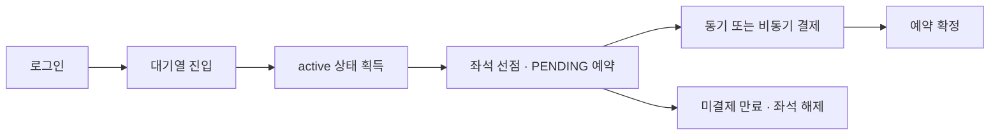

# Ticketing — 대기열 기반 콘서트 예매 시스템

예매 오픈 시점의 요청을 Redis 대기열로 제어하고, 좌석 선점부터 예약·결제·만료 복구까지 구현한 백엔드 프로젝트입니다.
좌석 경합에서의 데이터 정합성, 빠른 실패 전략, 부하테스트를 통한 병목 분석에 집중했습니다.

## 핵심 구현

| 주제 | 구현 내용 |
| --- | --- |
| 대기열 | Redis Sorted Set과 Lua 스크립트로 waiting/active 상태를 관리하고, active 사용자만 예약 진입 허용 |
| 좌석 정합성 | Redisson 분산락 경로에서 DB 조건부 갱신으로 예약 가능한 좌석만 선점. 비관적 락 전략도 비교 가능 |
| 빠른 실패 | 이미 선점된 좌석은 Redis 예약 불가 캐시로 걸러내고, 락 획득 대기 시간을 제한 |
| 결제·만료 복구 | 동기 결제와 RabbitMQ 비동기 결제 제공. 커밋 후 결제 메시지를 발행하고, 스케줄러로 만료 예약·좌석 정리 |
| 인프라·배포 | 로컬 MariaDB/MaxScale·Redis Sentinel HA 구성과 GitHub Actions·Nginx 기반 로컬 Blue/Green 배포 구성 |

## 검증 결과

| 검증 항목 | 조건 | 결과 |
| --- | --- | --- |
| 좌석 경합 응답 지연 | 동일 좌석에 300명 요청, 예약 불가 캐시·락 대기 시간 조정 | 예약 응답 p95 **2,053ms → 637ms**, 약 **69% 감소** |
| 중복 예약 방어 | 인기 좌석 500석에 2분간 18,000건 요청 | 예약 성공 **500건**, 중복 예약 **0건** |

## 기술 스택

| 영역 | 기술 |
| --- | --- |
| 애플리케이션 | Java 17, Spring Boot 3.5.8, Spring Security, Spring Session |
| 데이터·동시성 | MyBatis, MariaDB, Redis 7, Redisson, ShedLock |
| 메시징 | RabbitMQ 3.13 |
| 실행·배포 | Docker Compose, GitHub Actions, GHCR, Nginx |
| 테스트·관측 | JUnit 5, Testcontainers, k6, Actuator, MariaDB slow query log |

## 서비스 흐름



요청 경로는 [대기열 API](./src/main/java/com/ticketing/api/queue/controller/QueueController.java) · [예약 API](./src/main/java/com/ticketing/api/reservation/controller/ReservationController.java) · [결제 API](./src/main/java/com/ticketing/api/payment/controller/PaymentController.java)에서 확인할 수 있습니다.

## 기술 문서

### 핵심 문제 해결

| 주제 | 상세 문서 |
| --- | --- |
| 좌석 정합성 | [Redisson 분산락과 DB 조건부 갱신으로 좌석 중복 예약 방어하기](./docs/architecture/seat-consistency.md) |
| 병목 분석·성능 개선 | [예약 부하테스트로 Tomcat·Hikari 병목 분석하기](./docs/performance/reservation-baseline.md)<br/>[좌석 경합을 분석하고 빠른 실패로 예약 지연 줄이기](./docs/performance/reservation-fast-fail.md) |
| 배포·롤백 | [GitHub Actions와 Nginx로 로컬 자동 배포·롤백 구성하기](./docs/operations/deployment.md) |

### 관련 개념과 HA 구성

| 주제                | 상세 문서 |
|-------------------| --- |
| Redisson Watchdog | [Redisson WatchDog는 긴 작업 동안 락 TTL을 어떻게 지킬까](https://velog.io/@finebears/d-s9n93td7) |
| DB 락              | [Gap Lock과 Next-Key Lock](https://velog.io/@finebears/Gap-Lock%EA%B3%BC-Next-Key-Lock) |
| MariaDB HA        | [MariaDB를 3대로 늘리면 Primary 장애에도 예약을 계속 받을 수 있을까](https://velog.io/@finebears/MariaDB%EB%A5%BC-3%EB%8C%80%EB%A1%9C-%EB%8A%98%EB%A6%AC%EB%A9%B4-Primary-%EC%9E%A5%EC%95%A0%EC%97%90%EB%8F%84-%EC%98%88%EC%95%BD%EC%9D%84-%EA%B3%84%EC%86%8D-%EB%B0%9B%EC%9D%84-%EC%88%98-%EC%9E%88%EC%9D%84%EA%B9%8C) |
| Redis HA          | [Redis를 3대로 늘리면 예약 서비스의 장애도 해결될까](https://velog.io/@finebears/Redis%EB%A5%BC-3%EB%8C%80%EB%A1%9C-%EB%8A%98%EB%A6%AC%EB%A9%B4-%EC%98%88%EC%95%BD-%EC%84%9C%EB%B9%84%EC%8A%A4%EC%9D%98-%EC%9E%A5%EC%95%A0%EB%8F%84-%ED%95%B4%EA%B2%B0%EB%90%A0%EA%B9%8C) |
| 트랜잭션 이벤트          | [publishEvent() 이후 @TransactionalEventListener(AFTER_COMMIT)는 실제로 언제 실행될까](https://velog.io/@finebears/publishEvent-%EC%9D%B4%ED%9B%84-TransactionalEventListenerAFTERCOMMIT%EB%8A%94-%EC%8B%A4%EC%A0%9C%EB%A1%9C-%EC%96%B8%EC%A0%9C-%EC%8B%A4%ED%96%89%EB%90%A0%EA%B9%8C)<br/>[@TransactionalEventListener(AFTER_COMMIT)만으로 메시지 정합성을 보장할 수 있을까](https://velog.io/@finebears/TransactionalEventListenerAFTERCOMMIT%EB%A7%8C%EC%9C%BC%EB%A1%9C-%EB%A9%94%EC%8B%9C%EC%A7%80-%EC%A0%95%ED%95%A9%EC%84%B1%EC%9D%84-%EB%B3%B4%EC%9E%A5%ED%95%A0-%EC%88%98-%EC%9E%88%EC%9D%84%EA%B9%8C) |

## 로컬 실행

Docker Compose를 사용할 수 있는 환경에서 저장소 루트에서 실행합니다.

```bash
docker compose up -d --build
```
