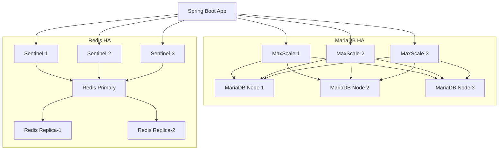
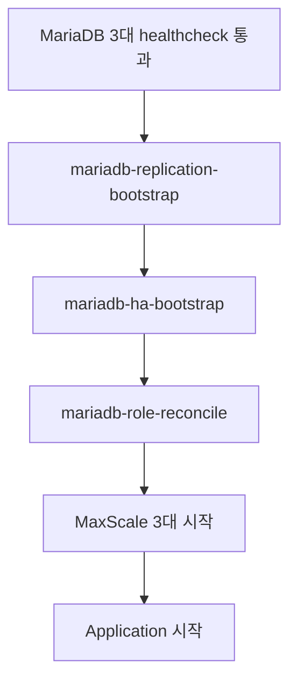
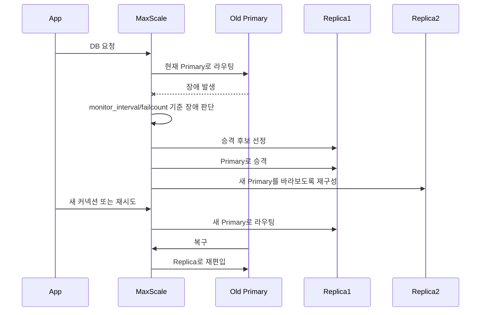

# MariaDB / Redis 고가용성 아키텍처 정리

## 1. 문서 목적

이 문서는 티켓팅 프로젝트에 적용한 MariaDB, Redis 고가용성 구조를 정리하기 위한 문서다.

이 프로젝트는 기존의 단일 MariaDB / 단일 Redis 구조에서 벗어나 다음 목표를 달성하는 방향으로 아키텍처를 확장했다.

- MariaDB Primary 장애 시 Replica 자동 승격
- 애플리케이션이 MariaDB 실제 Primary 노드를 직접 알 필요 없는 구조
- MaxScale 장애까지 고려한 DB Proxy 이중화/삼중화
- Redis Primary 장애 시 Sentinel 기반 자동 Failover
- Redis 기반 분산락, 세션, 대기열, 캐시가 단일 Redis 장애에 묶이지 않도록 개선
- 복제 토폴로지 꼬임, split-brain, 잘못된 read/write 역할을 방지
- 로컬 개발/검증 환경에서도 HA 구조를 재현할 수 있도록 Docker Compose 기반 구성

한 줄로 요약하면, 이 프로젝트의 HA 구조는 다음과 같다.

> MariaDB는 GTID 기반 Primary-Replica 복제와 MaxScale 3중화를 적용하여 Primary 장애 시 자동 승격 및 재편입이 가능하도록 구성했고, Redis는 Sentinel 3대 기반으로 Master 장애 감지와 자동 Failover를 구성했다. 또한 티켓팅 도메인의 정합성을 고려해 Replica 읽기 분산은 의도적으로 제외하고, 모든 DB 요청과 분산락을 현재 Master 기준으로 처리하도록 설계했다.

---

## 2. 전체 아키텍처 개요

현재 구조는 크게 세 영역으로 나뉜다.

| 영역 | 구성 | 목적 |
|---|---|---|
| MariaDB HA | MariaDB 3대 + MaxScale 3대 | RDB 장애 대응, 자동 Failover, DB 연결 추상화 |
| Redis HA | Redis 3대 + Sentinel 3대 | Redis Master 장애 감지, 자동 Failover, 분산락/세션/큐 안정성 확보 |
| Application | Spring Boot 1대 이상 실행 가능 | MaxScale / Sentinel을 통해 현재 쓰기 가능한 노드에 접근 |



이 구조에서 애플리케이션은 MariaDB나 Redis의 실제 Primary를 직접 판단하지 않는다.

- MariaDB의 현재 Primary 판단은 MaxScale이 담당한다.
- Redis의 현재 Master 판단은 Sentinel이 담당한다.
- 애플리케이션은 MaxScale endpoint와 Sentinel endpoint를 바라본다.

즉, 단순히 Replica를 추가한 것이 아니라, 장애 감지와 라우팅 계층까지 함께 구성한 구조다.

---

## 3. 왜 단순 Master-Slave만으로 부족한가?

초기에는 “고가용성 확보 = Master-Slave 구성”처럼 생각하기 쉽다.

하지만 Replica만 추가하면 다음 문제가 남는다.

1. Primary가 죽었을 때 누가 새 Primary가 되는지 애플리케이션이 알 수 없다.
2. Replica를 수동 승격하면 JDBC URL이나 접속 정보를 바꿔야 할 수 있다.
3. 여러 노드가 동시에 Primary라고 판단하면 split-brain이 발생할 수 있다.
4. 장애 후 기존 Primary가 복구되었을 때 다시 Replica로 재편입해야 한다.
5. Redis도 단순 Replica만으로는 Master 장애 시 자동 전환이 되지 않는다.

그래서 이 프로젝트에서는 다음 계층을 추가했다.

| 대상 | 단순 복제만으로 남는 문제 | 추가한 구성 |
|---|---|---|
| MariaDB | Primary 장애 감지, 자동 승격, 애플리케이션 라우팅 문제 | MaxScale |
| Redis | Master 장애 감지, 자동 승격, 클라이언트의 Master 탐색 문제 | Redis Sentinel |

---

## 4. MariaDB HA 구성

## 4.1 구성 요소

MariaDB 영역은 다음 컴포넌트로 구성된다.

| 구성 요소 | 개수 | 역할 |
|---|---:|---|
| MariaDB | 3대 | 1 Primary + 2 Replica |
| MaxScale | 3대 | DB Proxy, Primary 라우팅, 장애 감지, 자동 Failover |
| `mariadb-replication-bootstrap` | 1회성 | 최초 복제 토폴로지 구성 |
| `mariadb-ha-bootstrap` | 1회성 | MaxScale용 DB 계정/권한 생성 |
| `mariadb-role-reconcile` | 1회성 | 현재 Primary/Replica 역할 검증 및 `read_only` 정렬 |

관련 파일은 다음과 같다.

- `docker-compose.yml`
- `infra/mariadb-ha/primary.cnf`
- `infra/mariadb-ha/replica-1.cnf`
- `infra/mariadb-ha/replica-2.cnf`
- `infra/mariadb-ha/bootstrap-mariadb-replication.sh`
- `infra/mariadb-ha/reconcile-mariadb-roles.sh`
- `infra/mariadb-ha/maxscale/maxscale.cnf`
- `infra/mariadb-ha/maxscale/bootstrap-maxscale-users.sh`

---

## 4.2 MariaDB 노드

MariaDB는 다음 3개 컨테이너로 구성된다.

- `mariadb-primary`
- `mariadb-replica-1`
- `mariadb-replica-2`

주의할 점은 컨테이너 이름의 `primary`, `replica`가 영구 역할을 의미하지 않는다는 것이다.

초기 부트스트랩 시에는 `mariadb-primary`가 최초 Primary가 된다. 그러나 장애가 발생하면 `mariadb-replica-1` 또는 `mariadb-replica-2`가 새 Primary로 승격될 수 있다. 이후 기존 `mariadb-primary`가 복구되면 Replica로 재편입될 수 있다.

즉, 컨테이너 이름은 초기 역할을 표현할 뿐이고, 실제 운영 중 역할은 MaxScale이 판단하고 관리한다.

---

## 4.3 MariaDB 복제 방식

MariaDB는 GTID 기반 복제를 사용한다.

공통적으로 중요한 설정은 다음과 같다.

```cnf
log_bin
binlog_format=ROW
gtid_strict_mode=ON
log_slave_updates=ON
sync_binlog=1
innodb_flush_log_at_trx_commit=1
expire_logs_days=7
character_set_server=utf8mb4
collation_server=utf8mb4_unicode_ci
```

각 설정의 의미는 다음과 같다.

| 설정 | 의미 | 적용 이유 |
|---|---|---|
| `log_bin` | Binary log 활성화 | 복제 이벤트 기록의 기반 |
| `binlog_format=ROW` | 변경된 row 기준으로 binlog 기록 | Statement 기반보다 데이터 정합성에 유리 |
| `gtid_strict_mode=ON` | GTID 기반 복제 엄격 적용 | Failover/Rejoin 시 복제 위치 비교 용이 |
| `log_slave_updates=ON` | Replica가 받은 복제 이벤트도 자신의 binlog에 기록 | Replica가 승격된 후 다른 노드의 복제 원본이 될 수 있도록 함 |
| `sync_binlog=1` | 커밋 시 binlog flush 강화 | 장애 시 binlog 유실 가능성 감소 |
| `innodb_flush_log_at_trx_commit=1` | 커밋 시 redo log flush 강화 | 트랜잭션 내구성 강화 |
| `expire_logs_days=7` | 오래된 binlog 정리 | 디스크 사용량 방어 |
| `utf8mb4` | 문자셋 설정 | 한글/이모지 등 유니코드 데이터 대응 |

특히 `log_slave_updates=ON`은 모든 MariaDB 노드에 동일하게 들어가야 한다.

Replica가 새 Primary로 승격된 뒤 다른 Replica들이 이 노드를 따라가려면, 승격된 Replica도 자신이 받은 트랜잭션을 binlog로 가지고 있어야 하기 때문이다.

---

## 4.4 MariaDB 부트스트랩 흐름

Docker Compose는 단순히 여러 컨테이너를 동시에 띄우는 방식이 아니라, 초기화 순서를 강제한다.



이 순서가 필요한 이유는 MaxScale이 기동되기 전에 MariaDB 복제 토폴로지가 정상이어야 하기 때문이다.

---

## 4.5 `mariadb-replication-bootstrap`

`infra/mariadb-ha/bootstrap-mariadb-replication.sh`의 역할은 MariaDB 복제 토폴로지를 구성하는 것이다.

주요 동작은 다음과 같다.

1. 3개 MariaDB 노드에 replication user를 생성한다.
2. 현재 각 노드의 `SHOW REPLICA STATUS`를 확인한다.
3. 복제 토폴로지가 전혀 없으면 `mariadb-primary`를 최초 Master로 선택한다.
4. `mariadb-replica-1`, `mariadb-replica-2`에 `CHANGE MASTER TO`와 `START SLAVE`를 실행한다.
5. Replica의 `Slave_IO_Running`, `Slave_SQL_Running`이 모두 `Yes`인지 확인한다.
6. 이미 복제 토폴로지가 있으면 기존 구조를 감지하고 재사용한다.
7. Master 후보가 0개 또는 2개 이상이면 중단하여 잘못된 토폴로지 선택을 막는다.

이 스크립트에서 중요한 점은 “항상 `mariadb-primary`를 Master로 덮어쓰지 않는다”는 것이다.

예를 들어 이전에 장애가 발생해서 `mariadb-replica-1`이 새 Primary가 된 상태라면, 재기동 시 이 상태를 감지해야 한다. 그렇지 않으면 이미 승격된 Primary 구조를 다시 깨뜨릴 수 있다.

그래서 이 스크립트는 현재 복제 상태를 먼저 확인하고, Master 후보가 정확히 하나일 때만 기존 토폴로지를 인정한다.

---

## 4.6 `mariadb-ha-bootstrap`

`infra/mariadb-ha/maxscale/bootstrap-maxscale-users.sh`의 역할은 MaxScale이 MariaDB를 모니터링하고 라우팅할 수 있도록 계정을 생성하는 것이다.

계정은 크게 두 종류다.

| 계정 | 역할 |
|---|---|
| `maxscale_monitor` | MariaDB 상태 확인, Primary/Replica 감지, Failover/Rejoin 제어 |
| `maxscale_service` | 애플리케이션 쿼리를 라우팅하기 위해 MaxScale 서비스가 사용하는 계정 |

`maxscale_monitor`에는 다음 계열 권한이 필요하다.

- `REPLICA MONITOR`
- `REPLICATION CLIENT`
- `READ_ONLY ADMIN`
- `PROCESS`
- `RELOAD`
- `SHOW DATABASES`

기존에는 `REPLICATION SLAVE` 권한을 부여할 수 있었지만, 이 권한은 “복제를 수행하는 계정”에 더 가깝다. MaxScale monitor user에는 MariaDB 상태 확인과 복제 상태 조회를 위한 모니터링 권한이 더 적절하다.

현재 스크립트는 기존 볼륨에 `REPLICATION SLAVE` 권한이 남아 있을 경우 이를 제거하고, 모니터링에 필요한 권한을 다시 부여한다.

---

## 4.7 `mariadb-role-reconcile`

`infra/mariadb-ha/reconcile-mariadb-roles.sh`의 역할은 MaxScale 기동 전에 MariaDB 역할 상태가 안전한지 확인하는 것이다.

검증 기준은 다음과 같다.

1. Master 후보가 정확히 1개여야 한다.
2. 모든 Replica는 동일한 Master를 바라봐야 한다.
3. Replica의 IO thread와 SQL thread가 모두 정상이어야 한다.
4. Master는 `read_only=OFF`여야 한다.
5. Replica는 `read_only=ON`이어야 한다.

이 스크립트의 핵심은 위험한 상태에서 자동 복구를 시도하지 않고 중단한다는 점이다.

예를 들어 Master 후보가 2개라면 이는 split-brain 가능성이 있는 상태다. 이때 임의로 하나를 골라 진행하면 데이터 불일치를 더 키울 수 있다. 따라서 스크립트는 명시적으로 실패한다.

이 판단은 운영 관점에서 중요하다.

> 잘못된 자동화보다 명시적 실패가 더 안전하다.

---

## 5. MaxScale 구성

## 5.1 MaxScale을 둔 이유

애플리케이션이 MariaDB 3대에 직접 연결하면 다음 문제가 생긴다.

- 현재 Primary가 누구인지 애플리케이션이 알아야 한다.
- Primary 장애 후 새 Primary로 연결을 바꿔야 한다.
- Replica에 쓰기 요청이 들어가면 실패하거나 정합성 문제가 생길 수 있다.
- 장애 후 복구된 노드의 재편입을 별도로 처리해야 한다.

MaxScale은 이 문제를 애플리케이션 바깥에서 해결한다.

MaxScale의 역할은 다음과 같다.

- MariaDB 노드 상태 모니터링
- 현재 Primary 탐지
- Primary 장애 시 Replica 자동 승격
- 기존 Primary 복구 시 Replica로 재편입
- 애플리케이션 요청을 현재 Primary로 라우팅
- Replica를 `read_only`로 강제
- Master를 writable 상태로 강제

---

## 5.2 MaxScale 3대 구성

현재 MaxScale은 3대다.

- `maxscale-1`
- `maxscale-2`
- `maxscale-3`

애플리케이션은 MaxScale 3대를 순차 후보로 가진다.

```text
jdbc:mariadb:sequential://maxscale-1:4006,maxscale-2:4006,maxscale-3:4006/ticketing
```

따라서 MaxScale 1대가 죽어도 다른 MaxScale로 연결할 수 있다.

처음에는 MaxScale 2대 구성도 가능해 보였지만, cooperative monitoring 관점에서는 3대가 더 안정적이다.

현재 설정은 다음과 같다.

```cnf
cooperative_monitoring_locks=majority_of_all
```

3대 구성에서 과반은 2대다.

| 상황 | 결과 |
|---|---|
| MaxScale 1대 장애 | 남은 2대가 과반 유지 가능 |
| MaxScale 2대 장애 | 과반 불가, 자동 Failover 중단 |

이 구조는 split-brain 방지에 유리하다.

---

## 5.3 MaxScale 모니터링 설정

`infra/mariadb-ha/maxscale/maxscale.cnf`의 주요 설정은 다음과 같다.

```cnf
monitor_interval=2s
failcount=3
auto_failover=true
auto_rejoin=true
cooperative_monitoring_locks=majority_of_all
enforce_read_only_slaves=true
enforce_writable_master=true
journal_max_age=2592000s
```

| 설정 | 의미 |
|---|---|
| `monitor_interval=2s` | 2초마다 MariaDB 상태 확인 |
| `failcount=3` | 연속 3회 실패 시 장애로 판단 |
| `auto_failover=true` | Primary 장애 시 자동 Failover 수행 |
| `auto_rejoin=true` | 복구된 기존 Primary를 Replica로 자동 재편입 |
| `cooperative_monitoring_locks=majority_of_all` | MaxScale 다중 인스턴스 간 과반 기반 Failover 조율 |
| `enforce_read_only_slaves=true` | Replica는 read_only 상태로 강제 |
| `enforce_writable_master=true` | Master는 writable 상태로 강제 |
| `journal_max_age=2592000s` | MaxScale 장애 조치 기록 유지 기간 |

`monitor_interval=2s`와 `failcount=3`이므로, 장애 판단에는 최소 약 6초 이상의 시간이 필요하다. 실제 Failover 완료 시간은 네트워크, 컨테이너 상태, 복제 상태에 따라 더 길어질 수 있다.

---

## 5.4 모든 쿼리를 Master로 라우팅한 이유

현재 MaxScale 서비스는 다음처럼 구성되어 있다.

```cnf
[Primary-Service]
router=readconnroute
router_options=master
```

즉, SELECT를 포함한 모든 쿼리를 현재 Master로 보낸다.

Replica 2대는 읽기 분산용이 아니라 다음 용도로 사용한다.

- Primary 장애 시 승격 후보
- 장애 복구 시 재편입 대상
- 데이터 복제본 유지

이 선택은 티켓팅 도메인의 정합성을 고려한 것이다.

티켓팅 서비스에서는 좌석 상태, 예약 상태, 결제 상태처럼 “방금 쓴 데이터를 바로 읽어야 하는” 경우가 많다. Replica로 읽기 분산을 하면 복제 지연 때문에 stale read가 발생할 수 있다.

예를 들어 어떤 좌석이 방금 예약되었는데 Replica에는 아직 반영되지 않았다면, 다른 사용자가 해당 좌석을 아직 비어 있다고 볼 수 있다.

따라서 현재 구조에서는 읽기 확장보다 정합성과 장애 대응을 우선했다.

---

## 6. MariaDB 장애 시 동작 흐름

MariaDB Primary 장애가 발생하면 흐름은 다음과 같다.



이 구조에서 애플리케이션은 “현재 MariaDB Primary가 누구인지” 직접 알 필요가 없다.

애플리케이션은 MaxScale을 바라보고, MaxScale이 현재 Primary를 추적한다.

---

## 7. 애플리케이션의 MariaDB 연결 구조

`dev` profile의 애플리케이션은 MaxScale 3대를 바라본다.

```yaml
spring:
  datasource:
    url: ${MARIADB_HA_JDBC_URL:jdbc:mariadb:sequential://localhost:14006,localhost:14007,localhost:14008/ticketing?useUnicode=true&characterEncoding=utf8&connectTimeout=2000}
```

Docker Compose 내부에서는 다음 URL을 사용한다.

```yaml
MARIADB_HA_JDBC_URL: jdbc:mariadb:sequential://maxscale-1:4006,maxscale-2:4006,maxscale-3:4006/ticketing?useUnicode=true&characterEncoding=utf8&connectTimeout=2000
```

여기서 핵심은 두 가지다.

1. 애플리케이션은 MariaDB 노드가 아니라 MaxScale 노드에 연결한다.
2. MaxScale이 여러 대이므로 Proxy 단일 장애도 어느 정도 회피할 수 있다.

또한 `allowMultiQueries=true`는 제거했다.

MyBatis mapper를 확인한 결과, 현재 mapper에는 다중 SQL 실행이 필요한 패턴이 없었다.

- `${}` 없음
- `statementType` 없음
- `CALL`, `BEGIN`, `END` 기반 프로시저 호출 없음
- `separator=";"` 없음
- `<foreach>`는 `separator=","` 기반 bulk insert 용도

따라서 SQL injection의 파급면을 키울 수 있는 `allowMultiQueries=true`를 유지할 이유가 없다고 판단했다.

---

## 8. Redis HA 구성

## 8.1 구성 요소

Redis 영역은 다음 컴포넌트로 구성된다.

| 구성 요소 | 개수 | 역할 |
|---|---:|---|
| Redis | 3대 | 1 Primary + 2 Replica |
| Redis Sentinel | 3대 | Redis Master 감시, 장애 판단, Failover |
| Redisson | App 내부 | Sentinel 기반 분산락 |
| Spring Data Redis | App 내부 | 세션, 캐시, 대기열 데이터 접근 |

이 프로젝트에서 Redis는 단순 캐시가 아니다.

Redis는 다음 기능에 사용된다.

- 대기열 관리
- 활성 사용자 검증
- 세션 저장소
- 캐시
- 좌석 임시 불가 캐시
- 분산락
- Scheduler lock

따라서 Redis 장애는 단순히 캐시 miss가 늘어나는 문제가 아니라, 티켓팅 서비스의 동시성 제어와 사용자 흐름에 직접 영향을 줄 수 있다.

---

## 8.2 Redis 노드 구성

Redis는 다음 3개 노드로 구성된다.

- `redis-primary`
- `redis-replica-1`
- `redis-replica-2`

Replica들은 초기에는 Primary를 바라본다.

```yaml
--replicaof 172.30.10.10 6379
```

Redis와 Sentinel은 Docker 네트워크에서 고정 IP를 사용한다.

| 노드 | IP |
|---|---|
| `redis-primary` | `172.30.10.10` |
| `redis-replica-1` | `172.30.10.11` |
| `redis-replica-2` | `172.30.10.12` |
| `redis-sentinel-1` | `172.30.10.21` |
| `redis-sentinel-2` | `172.30.10.22` |
| `redis-sentinel-3` | `172.30.10.23` |

고정 IP를 사용한 이유는 Sentinel failover 검증 중 Docker DNS와 컨테이너 중지 상태가 맞물렸을 때, 죽은 컨테이너의 이름 해석이 장애 복구를 방해할 수 있었기 때문이다.

Sentinel이 감시하는 최초 Master endpoint를 안정적으로 유지하기 위해 고정 IP 기반으로 정리했다.

---

## 8.3 Redis 데이터 안전성 설정

Redis에는 다음 설정을 적용했다.

```yaml
--appendonly yes
--appendfsync everysec
--min-replicas-to-write 1
--min-replicas-max-lag 10
```

각 설정의 의미는 다음과 같다.

| 설정 | 의미 | 적용 이유 |
|---|---|---|
| `appendonly yes` | AOF 활성화 | Redis 재시작 후 데이터 복구 가능성 확보 |
| `appendfsync everysec` | AOF를 매초 fsync | 성능과 내구성의 균형 |
| `min-replicas-to-write 1` | 최소 1개 Replica가 정상이어야 쓰기 허용 | Primary 고립 상태에서 쓰기 누적 방지 |
| `min-replicas-max-lag 10` | Replica 지연이 10초 이내여야 정상으로 간주 | 너무 뒤처진 Replica를 정상 복제본으로 보지 않음 |

`min-replicas-to-write 1`은 Redis 정합성 방어선으로 중요하다.

Primary가 Replica 없이 혼자 고립된 상태에서 계속 쓰기를 받아버리면, 이후 Failover 시 데이터 불일치나 유실 가능성이 커진다.

이 설정은 “최소한 하나의 Replica가 따라오지 못하면 쓰기를 멈추겠다”는 선택이다.

---

## 9. Redis Sentinel 구성

Redis Sentinel은 3대다.

- `redis-sentinel-1`
- `redis-sentinel-2`
- `redis-sentinel-3`

Sentinel의 역할은 다음과 같다.

- Redis Primary 감시
- Primary 장애 판단
- Replica 중 하나를 새 Primary로 승격
- 나머지 Replica가 새 Primary를 바라보도록 재구성
- 애플리케이션에 현재 Master 정보 제공

주요 설정은 다음과 같다.

```yaml
SENTINEL_QUORUM: 2
SENTINEL_DOWN_AFTER_MILLISECONDS: 5000
SENTINEL_FAILOVER_TIMEOUT: 60000
SENTINEL_PARALLEL_SYNCS: 1
```

| 설정 | 의미 |
|---|---|
| `SENTINEL_QUORUM=2` | Sentinel 2대 이상이 동의해야 장애로 판단 |
| `down-after-milliseconds=5000` | 5초 이상 응답 없으면 주관적 장애로 판단 |
| `failover-timeout=60000` | Failover 제한 시간 |
| `parallel-syncs=1` | Failover 후 Replica 재동기화를 한 번에 1대씩 진행 |

3대 Sentinel에 quorum 2를 둔 이유는 Sentinel 1대 장애에도 판단 능력을 유지하기 위해서다.

---

## 10. 애플리케이션의 Redis 연결 구조

`dev` profile에서는 Spring Redis가 Sentinel을 바라본다.

```yaml
spring:
  data:
    redis:
      sentinel:
        master: ticketing-master
        nodes:
          - localhost:26379
          - localhost:26380
          - localhost:26381
```

Docker 내부에서는 다음 환경변수로 Sentinel endpoint가 전달된다.

```yaml
REDIS_HA_SENTINEL_1: redis-sentinel-1:26379
REDIS_HA_SENTINEL_2: redis-sentinel-2:26379
REDIS_HA_SENTINEL_3: redis-sentinel-3:26379
```

즉, 애플리케이션은 Redis Primary에 직접 붙지 않는다.

애플리케이션은 Sentinel을 통해 현재 Master를 찾고, Redis 장애 후에도 새 Master로 연결할 수 있다.

---

## 11. Redisson 분산락 구조

현재 락 전략은 Redisson 기반이다.

```yaml
ticketing:
  lock:
    strategy: REDISSON
```

`dev` profile에서는 Sentinel 기반 Redisson 설정을 사용한다.

```java
@Profile("dev")
public class RedissonSentinelConfig
```

`standalone`, `loadtest` profile에서는 단일 Redis 설정을 사용한다.

```java
@Profile({"standalone", "loadtest"})
public class RedissonSingleServerConfig
```

Redisson Sentinel 설정에서는 다음 옵션을 사용한다.

```java
.setReadMode(ReadMode.MASTER)
.setSubscriptionMode(SubscriptionMode.MASTER)
```

분산락은 최신 상태와 원자성이 중요하므로 Replica read를 사용하지 않고 Master 기준으로만 동작하도록 했다.

---

## 12. Profile 분리 전략

현재 profile은 다음처럼 분리했다.

| Profile | DB 구조 | Redis 구조 | 목적 |
|---|---|---|---|
| `dev` | MariaDB HA + MaxScale | Redis Sentinel | 기본 HA 검증 환경 |
| `standalone` | 단일 MariaDB | 단일 Redis | 단순 실행/백업용 |
| `loadtest` | 단일 MariaDB | 단일 Redis | 부하 테스트용 분리 |

`application.yml`에는 공통 설정만 두고, DB/Redis 접속 구조는 profile별 설정 파일에 분리했다.

이렇게 한 이유는 HA 설정과 단일 설정이 한 파일에 섞이면 어떤 환경에서 어떤 DB에 붙는지 추적하기 어려워지기 때문이다.

---

## 13. 포트 노출 정책

DB, Redis, Sentinel, RabbitMQ 포트는 외부 전체 인터페이스에 열지 않고 `127.0.0.1`에 바인딩했다.

예시는 다음과 같다.

```yaml
127.0.0.1:13306:3306
127.0.0.1:14006:4006
127.0.0.1:16379:6379
127.0.0.1:26379:26379
127.0.0.1:5672:5672
127.0.0.1:15672:15672
```

이 설정은 로컬 개발/검증 환경에서는 호스트에서 접근 가능하게 하면서, 외부 네트워크에 DB나 메시지 브로커 포트를 직접 노출하지 않기 위한 선택이다.

---

## 14. RabbitMQ 상태

RabbitMQ는 현재 HA 대상이 아니다.

현재 적용된 것은 포트 노출 범위 축소다.

```yaml
- "127.0.0.1:5672:5672"
- "127.0.0.1:15672:15672"
```

즉, RabbitMQ는 단일 노드이며, 결제 이벤트 경로까지 완전한 HA를 구성하려면 추후 다음을 검토해야 한다.

- RabbitMQ cluster
- quorum queue
- durable queue
- persistent message
- consumer 재처리 전략
- DLQ 구성

현재 아키텍처에서 RabbitMQ는 HA 범위에 포함하지 않았다.

따라서 이 문서에서는 MariaDB/Redis의 고가용성 구성과 RabbitMQ의 포트 노출 범위 축소를 명확히 구분한다. RabbitMQ까지 고가용성 대상으로 확장하려면 클러스터링과 quorum queue 구성이 별도로 필요하다.

---

## 15. 정합성을 우선한 설계 선택

이 아키텍처에서 중요한 선택은 읽기 분산을 의도적으로 제외했다는 점이다.

Replica가 있으니 SELECT를 Replica로 보내면 읽기 성능은 높일 수 있다. 하지만 티켓팅 서비스에서는 다음 데이터의 최신성이 중요하다.

- 좌석 예약 상태
- 결제 상태
- 대기열 활성 상태
- 임시 선점 상태
- 예약 만료 처리 상태

Replica는 구조적으로 Primary보다 늦을 수 있다.

복제 지연이 짧더라도, 좌석 예약처럼 경쟁이 강한 도메인에서는 stale read가 큰 문제가 될 수 있다.

따라서 현재 구조는 다음 원칙을 따른다.

- MariaDB Replica는 읽기 분산보다 Failover 후보로 사용한다.
- MaxScale은 모든 쿼리를 현재 Master로 라우팅한다.
- Redisson도 Master 기준으로 락을 수행한다.
- Redis도 최소 Replica 조건을 만족하지 못하면 쓰기를 거부한다.

즉, 이 구조의 목적은 읽기 성능 확장보다 장애 대응과 정합성 유지다.

---

## 16. 장애 대응 효과

## 16.1 MariaDB Primary 장애

기존 단일 DB 구조에서는 MariaDB가 죽으면 애플리케이션의 DB 요청이 바로 실패한다.

현재 구조에서는 MaxScale이 Primary 장애를 감지하고 Replica를 승격한다.

애플리케이션은 MaxScale endpoint를 바라보고 있으므로, DB 노드가 바뀌어도 연결 경로를 유지할 수 있다.

## 16.2 MaxScale 장애

MaxScale도 3대다.

애플리케이션 JDBC URL은 MaxScale 3대를 후보로 가진다.

```text
maxscale-1:4006,maxscale-2:4006,maxscale-3:4006
```

따라서 MaxScale 1대 장애 시에도 다른 MaxScale로 연결할 수 있다.

## 16.3 Redis Primary 장애

Redis Primary가 죽으면 Sentinel이 quorum 기준으로 장애를 판단한다.

이후 Replica 중 하나를 새 Master로 승격하고, 애플리케이션은 Sentinel을 통해 새 Master를 찾아간다.

## 16.4 Redis Sentinel 장애

Sentinel은 3대이며 quorum은 2다.

Sentinel 1대가 죽어도 나머지 2대가 quorum을 만족할 수 있다.

---

## 17. 실제 검증한 내용

적용 과정에서 다음을 검증했다.

- MariaDB replication 정상 동작 확인
- MariaDB Primary 중지 후 Replica 승격 확인
- MaxScale을 통한 새 Primary write 성공 확인
- 기존 MariaDB Primary 재기동 후 Replica로 rejoin 확인
- Redis Primary 중지 후 Sentinel 기반 Failover 확인
- Redis 새 Master write 성공 확인
- 기존 Redis Primary 재기동 후 Replica로 rejoin 확인
- RabbitMQ 포트가 `127.0.0.1`로만 바인딩되는지 확인
- `allowMultiQueries=true` 제거 후 profile 설정 테스트 통과
- Docker Compose 설정 검증

테스트 관점에서 중요한 점은 단순히 컨테이너가 뜨는지만 본 것이 아니라, 실제 승격과 재편입까지 확인했다는 것이다.

---

## 18. 이 구조가 해결하지 않는 것

## 18.1 MariaDB는 완전 무손실 구조가 아니다

현재 MariaDB 복제는 기본적으로 비동기 replication이다.

Primary가 커밋한 직후 Replica로 전달되기 전에 Primary가 죽으면, 아주 최근 트랜잭션은 유실될 수 있다.

즉, RPO가 항상 0이라고 말할 수 없다.

완전 무손실에 더 가깝게 가려면 다음 대안을 검토해야 한다.

- semi-sync replication
- Galera Cluster
- 더 강한 동기화 기반의 클러스터 구조

다만 이런 선택지는 성능과 운영 복잡도를 함께 증가시킨다.

현재 구조는 Docker Compose 기반 검증 환경에서 운영형 HA의 핵심 흐름을 재현하기 위한 균형점이다. 데이터 무손실을 최우선으로 하는 운영 환경이라면 semi-sync replication이나 Galera Cluster 같은 대안을 추가로 검토해야 한다.

## 18.2 읽기 확장 구조는 아니다

Replica가 있지만 SELECT 부하 분산을 하지 않는다.

이 구조의 목적은 읽기 성능 향상보다 장애 대응과 정합성 유지다.

읽기 확장이 필요하다면 다음을 검토할 수 있다.

- MaxScale Read-Service 추가
- `readwritesplit` router 적용
- 일관성이 덜 중요한 조회만 Replica로 분리

## 18.3 RabbitMQ는 아직 HA가 아니다

RabbitMQ는 포트 보안은 개선했지만 단일 노드다.

결제 이벤트 큐가 중요한 경로라면 추후 HA 대상이다.

## 18.4 Docker Compose 기반 검증 환경이다

현재 구조는 Docker Compose 기반이다.

실제 운영 수준으로 가려면 추가로 다음이 필요하다.

- Secret Manager
- 백업/복구 전략
- 모니터링/알림
- 로그 수집
- 장애 리허설 자동화
- 데이터 볼륨 백업 정책
- 운영 환경별 리소스 제한
- 배포/롤백 전략

---

## 19. 아키텍처 적용 결과

이번 HA 적용을 통해 단일 MariaDB와 단일 Redis에 직접 의존하던 구조를 장애 감지, 자동 승격, 재편입이 가능한 구조로 확장했다.

MariaDB 영역에서는 GTID 기반 replication과 MaxScale 3중화를 적용했다. 이를 통해 Primary 장애 시 Replica가 자동 승격되고, 애플리케이션은 개별 MariaDB 노드가 아니라 MaxScale endpoint를 통해 현재 Primary로 라우팅된다. 또한 복구된 기존 Primary는 MaxScale의 `auto_rejoin` 흐름을 통해 Replica로 재편입될 수 있다.

Redis 영역에서는 Redis Primary + 2 Replica와 Sentinel 3대 구성을 적용했다. Redis Primary 장애 시 Sentinel quorum을 통해 장애를 판단하고 Replica 중 하나를 새 Master로 승격한다. 애플리케이션과 Redisson은 Sentinel 정보를 기반으로 현재 Master를 찾도록 구성했다.

이 구조에서 Replica는 읽기 부하 분산보다 장애 대응 후보로 사용한다. 티켓팅 서비스는 좌석 예약, 대기열, 결제 상태처럼 최신성이 중요한 데이터가 많기 때문에 stale read를 줄이는 방향을 우선했다. 따라서 MariaDB 쿼리와 Redisson 분산락은 모두 Master 중심으로 처리한다.

최종적으로 이 작업은 단순히 컨테이너 수를 늘리는 작업이 아니라, 상태 저장 계층의 단일 장애점을 줄이고 장애 발생 시 서비스가 복구 가능한 방향으로 이동하도록 아키텍처를 재설계한 작업이다.

---

## 20. 핵심 정리

이 아키텍처의 핵심은 단순히 컨테이너 수를 늘린 것이 아니다.

핵심은 다음 네 가지다.

1. MariaDB 장애 시 MaxScale이 현재 Primary를 추적하고 자동 Failover를 수행한다.
2. Redis 장애 시 Sentinel이 Master를 재선출하고 애플리케이션은 Sentinel을 통해 새 Master를 찾는다.
3. 티켓팅 도메인의 특성을 고려해 읽기 분산보다 정합성과 장애 대응을 우선했다.
4. 초기 부트스트랩과 role reconcile을 통해 잘못된 복제 토폴로지나 split-brain 가능성을 방어했다.

따라서 이 작업은 단순 설정 변경이 아니라, 애플리케이션의 상태 저장 계층을 단일 장애점 중심 구조에서 장애 감지/승격/재편입이 가능한 구조로 확장한 작업이다.
