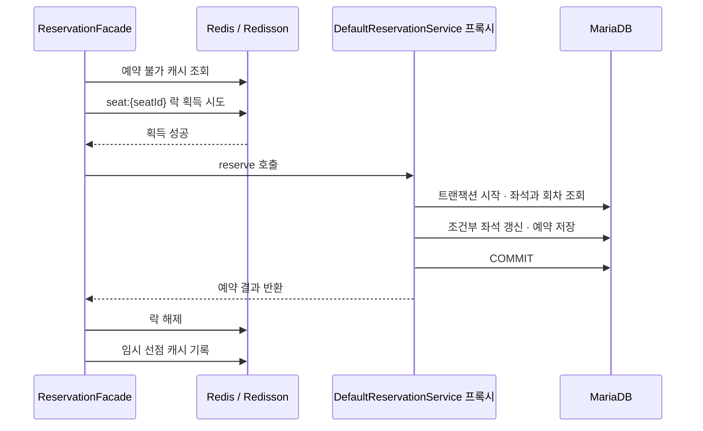

# Redisson 분산락과 DB 조건부 갱신으로 좌석 중복 예약 방어하기

콘서트 예매에서 같은 좌석을 선택한 두 요청은 거의 동시에 도착할 수 있다. 두 요청에 모두 예약 번호를 발급했다면, 응답이 아무리 빨라도 올바른 예매 처리는 아니다.

이 프로젝트의 기본 예약 경로는 좌석별 Redisson 분산락으로 경합을 조정하고, MariaDB의 조건부 갱신으로 실제 선점 가능 여부를 판단한다.

## 같은 좌석을 조회한 두 요청

[Seat.reserve()](../../src/main/java/com/ticketing/domain/seat/model/Seat.java)는 현재 상태가 `AVAILABLE`일 때만 객체를 `TEMPORARY`로 변경한다. 문제는 요청마다 조회한 객체가 서로 다르다는 점이다.

| 순서 | 요청 A | 요청 B |
| --- | --- | --- |
| 1 | 좌석을 조회하고 `AVAILABLE` 확인 | |
| 2 | | 같은 좌석을 조회하고 `AVAILABLE` 확인 |
| 3 | 자기 객체를 `TEMPORARY`로 변경 | |
| 4 | | 자기 객체를 `TEMPORARY`로 변경 |

일반 조회 후 객체의 상태만 검사하면 두 요청 모두 검사를 통과할 수 있다. 이후 좌석 ID만으로 갱신하고 각각 예약을 저장하는 흐름이라면, 마지막 좌석 소유자만 남으면서 예약 이력은 두 개 생길 위험이 있다.

따라서 예약 가능 여부는 객체를 읽은 시점뿐 아니라 **DB에서 상태를 변경하는 시점에도** 검사해야 한다.

## 기능요구사항

예약 생성 기능은 다음 요구사항을 만족해야 한다.

1. **같은 좌석에 유효한 예약이 중복되면 안 된다.**
   같은 공연 회차의 같은 좌석에 여러 사용자가 동시에 요청해도 유효한 예약은 하나만 생성되어야 한다. 이미 선점되었거나 판매가 완료된 좌석은 새로 예약할 수 없어야 한다.

2. **요청한 회차의 좌석만 예약할 수 있어야 한다.**
   선택한 좌석은 요청한 공연 회차에 속해야 한다. 공연이 시작된 이후에는 예약을 생성할 수 없어야 한다.

3. **좌석 선점과 예약 생성은 함께 성공하거나 함께 실패해야 한다.**
   좌석만 선점되고 예약 내역이 없거나, 예약은 생성되었는데 좌석이 선점되지 않은 상태가 남아서는 안 된다.

여기서 중복 예약은 같은 좌석에 유효한 예약이 동시에 존재하는 경우를 뜻한다.
예를 들어 A의 예약이 만료된 뒤 B가 같은 좌석을 예약했다면, A의 만료된 예약 이력과 B의 새 예약은 함께 남을 수 있다. 현재 유효한 예약은 B의 한 건이므로 중복 예약이 아니다.

## 기술적 대안

| 방법 | 보호하는 범위 | 이 프로젝트에서의 위치와 판단 |
| --- | --- | --- |
| `synchronized` 같은 JVM 내부 락 | 같은 JVM에서 동일한 락을 사용하는 요청 | 애플리케이션 인스턴스가 늘어나면 공통 조정 수단이 추가로 필요하다. |
| DB 비관적 락 | 트랜잭션에서 조회한 좌석 행 | `SELECT ... FOR UPDATE`를 사용하는 비교 경로가 존재한다. 경쟁 요청은 DB에서 대기하게 된다. |
| DB 조건부 갱신 | 현재 DB 상태가 조건을 만족하는 갱신 | 실제 좌석 선점의 최종 판단을 담당한다. 뒤의 예약 저장과 하나의 트랜잭션으로 묶는다. |
| Redisson 분산락 | 서로 다른 인스턴스에서 같은 좌석 락을 사용하는 요청 | 기본 경로에서 DB 작업 진입을 좌석별로 조정한다. 최종 선점 조건은 DB에서도 검사한다. |

### 최종적으로 Redisson을 선택한 이유

현재 프로젝트는 기본 락 전략으로 Redisson을 선택했다.
좌석별 경합을 DB 트랜잭션에 진입하기 전에 조정하고, 락의 수명 관리를 라이브러리에 맡기기 위해서다.

구체적인 선택 이유는 다음과 같다.

1. **여러 애플리케이션 인스턴스가 같은 좌석 락을 공유할 수 있다.**
   JVM 내부 락은 인스턴스마다 별도로 동작한다. Redisson은 같은 Redis와 같은 좌석 키를 사용하는 요청을 조정할 수 있으므로, 서버가 여러 대인 구성을 고려할 수 있다.

2. **예약 트랜잭션을 시작하기 전에 락 획득 대기를 제어할 수 있다.**
   현재 흐름은 Facade에서 락을 얻은 뒤 예약 서비스를 호출한다. `tryLock(waitTimeMs, TimeUnit.MILLISECONDS)`로 대기 시간을 제한하고, 시간 안에 얻지 못하면 예약 트랜잭션에 진입하지 않고 실패 처리할 수 있다.

3. **TTL 갱신과 락 소유권 관리를 직접 구현하는 범위를 줄일 수 있다.**
   Lettuce로 직접 구현하면 소유자 토큰, TTL 갱신 작업, 안전한 해제 등을 애플리케이션 코드가 관리해야 한다. Redisson을 사용하면 Watchdog 갱신과 소유 스레드 확인 등 락 관리 기능을 라이브러리를 통해 사용할 수 있다.

DB 비관적 락도 여러 인스턴스의 경쟁 요청을 제어할 수 있는 대안이다.

## 실제 요청 FLOW

예약 API는 active 사용자 검증을 통과한 뒤 `ReservationService`를 거쳐 [DistributedLockReservationFacade](../../src/main/java/com/ticketing/application/reservation/facade/DistributedLockReservationFacade.java)로 들어간다. 대기열은 예약 진입 대상을 제한하지만, 같은 좌석에 들어온 경쟁 요청을 하나로 만드는 역할까지 맡지는 않는다.

아래는 캐시에 예약 불가 정보가 없고 예약에 성공하는 경로다.



락 이름은 `seat:`와 전역 좌석 ID를 조합한다. 같은 좌석에는 같은 락이 사용되고, 다른 좌석은 서로 다른 락으로 처리된다. 실제 키 예시는 `seat:10`이다.

캐시에 예약 불가 정보가 있으면 락 진입 전에 경쟁 실패로 끝난다. 락을 얻지 못하면 `ReservationTooManyRequestsException`으로 변환되며, [ReservationExceptionHandler](../../src/main/java/com/ticketing/api/reservation/controller/ReservationExceptionHandler.java)가 `429`와 `Retry-After: 1`을 응답한다. 락 획득 실패를 좌석 선점 성공으로 취급하는 경로는 없다.

## 최종 선점 여부는 영향받은 행 수로 판단한다

[SeatMapper.xml](../../src/main/resources/mapper/seat/SeatMapper.xml)의 `reserveIfAvailable`은 다음 조건으로 좌석을 갱신한다.

```sql
UPDATE seats AS s
INNER JOIN concert_schedules AS cs ON cs.schedule_id = s.schedule_id
SET s.status = 'TEMPORARY',
    s.member_id = #{memberId},
    s.updated_at = NOW()
WHERE s.seat_id = #{seatId}
  AND s.schedule_id = #{scheduleId}
  AND s.status = 'AVAILABLE'
  AND cs.concert_date > NOW()
```

`seat_id`와 `schedule_id`가 맞아도 상태가 이미 `TEMPORARY`이면 갱신하지 않는다. 애플리케이션의 사전 검사 이후 공연이 시작된 경우에도 DB 시각 조건이 마지막으로 적용된다.

두 요청이 같은 좌석을 선점하려 해도, 먼저 성공한 트랜잭션이 커밋한 뒤에는 `AVAILABLE` 조건이 더 이상 성립하지 않는다. 선행 트랜잭션이 롤백한 경우에는 다음 요청이 성공할 수 있다. 필요한 것은 “처음 시도한 요청만 영원히 성공한다”가 아니라 “동시에 유효한 선점이 겹치지 않는다”는 조건이다.

[DefaultReservationService.reserve()](../../src/main/java/com/ticketing/application/reservation/service/DefaultReservationService.java)는 영향받은 행 수를 확인한다.

```java
int updatedRows = seatMapper.reserveIfAvailable(seatId, scheduleId, memberId);
if (updatedRows != 1) {
    throw new SeatAlreadyReservedException(ALREADY_RESERVED);
}
```

정확히 한 행을 선점한 요청만 다음 단계에서 예약을 저장한다. 객체의 `seat.reserve(memberId)` 검사를 통과했더라도, DB 검사에서 다른 요청의 선점이 확인되면 예약을 만들지 않는다.

영향 행 수가 0이라는 사실만으로 모든 원인을 구분할 수 있는 것은 아니다. SQL 실행 직전에 공연이 시작된 경우도 같은 예외로 처리된다. 현재 코드의 응답 의미를 읽을 때 이 점을 함께 봐야 한다.

## 커밋이 끝날 때까지 분산락을 잡는 이유

좌석 상태 변경과 예약 저장이 서로 다른 트랜잭션이라면, 좌석만 선점된 채 예약 생성은 실패하는 상황이 생길 수 있다. 현재 서비스는 두 작업을 같은 트랜잭션 안에서 실행한다.

또 하나의 경계는 Redis 락 해제 시점이다. 만약 락을 잡은 메서드 전체를 트랜잭션 프록시가 감싸고, 메서드 내부 `finally`에서 먼저 락을 풀면 **메서드 반환 이후 실제 커밋까지** 분산락이 없는 구간이 생길 수 있다.

현재 구조에서는 트랜잭션이 없는 Facade가 락 Executor를 호출하고, Executor의 `supplier` 안에서 별도 Spring Bean인 `DefaultReservationService`를 호출한다. 서비스의 `reserve()`에는 `@Transactional(propagation = Propagation.REQUIRES_NEW)`가 붙어 있다.

따라서 프록시가 서비스 호출을 정상 반환할 때는 내부 트랜잭션의 커밋까지 끝난 상태다. 그 뒤 [RedissonLockExecutor](../../src/main/java/com/ticketing/infrastructure/lock/executor/RedissonLockExecutor.java)의 `finally`에서 락을 해제한다.

```text
분산락 획득
  → Spring 프록시를 통한 트랜잭션 시작
  → 좌석 선점 + 예약 저장
  → 커밋 또는 롤백
분산락 해제
```

분리된 Bean 호출이라는 점도 필요하다. 같은 객체 안에서 일반 메서드 호출만 하는 구조로 바꾸면 Spring 프록시를 통한 트랜잭션 적용 여부를 다시 확인해야 한다.

`REQUIRES_NEW`는 바깥 트랜잭션과 독립된 물리 트랜잭션을 사용한다. 현재 예약 생성 진입 경로에는 바깥 트랜잭션이 없지만, 이후 추가하면 내부 예약 커밋과 외부 롤백이 분리되고 커넥션 사용량도 달라진다.

## 락 대기 시간과 캐시의 역할

### 락 대기 시간을 200ms로 제한한 이유

같은 좌석에 요청이 몰리면, 먼저 들어온 요청이 선점한 뒤 나머지는 락을 얻어도 예약에 실패하는 경우가 많다.

이 요청들을 계속 기다리게 하면 성공 가능성이 낮은 요청이 스레드를 오래 점유하면서 응답 지연과 후속 요청의 처리 부담을 키울 수 있다.

그래서 락 획득 대기를 200ms로 제한하고, 그 안에 얻지 못한 요청은 `429`로 빠르게 실패시키도록 했다.

100ms 조건에서는 300건 중 294건이 `429`였지만, 200ms에서는 65건으로 줄었다.

캐시를 켠 동일 좌석 300명 경합 실험에서 100·200·300·500ms를 비교했을 때, 200ms의 예약 p95가 `537.73ms`로 가장 낮아 기준값으로 선택했다.

### 예약 불가 캐시를 락 앞에 배치한 이유

이미 선점된 좌석의 반복 요청까지 락을 얻고 DB에 들어간 뒤 실패한다면, 예약할 수 없는 요청에도 불필요한 대기와 조회 비용이 발생한다.

그래서 [SeatUnavailableCacheRepository](../../src/main/java/com/ticketing/infrastructure/persistence/seat/SeatUnavailableCacheRepository.java)의 예약 불가 캐시를 락 획득 앞에 배치했다.

캐시에 선점 정보가 있으면 락 대기와 예약 DB 처리를 거치지 않고 `400`으로 빠르게 응답한다.

효과는 이미 선점된 좌석에 300명이 다시 요청하는 조건에서, 락 대기를 300ms로 고정하고 캐시 OFF와 ON을 비교했다.

캐시 적용 후 예약 p95는 `550.19ms → 445.44ms`로 약 19% 감소했고, 락 대기 초과 `429`는 `232건 → 0건`으로 줄었다.

캐시는 실패할 요청의 처리 비용을 줄이는 장치다. 캐시가 없거나 조회에 실패하면 기존 락·DB 검사를 진행하며, 최종 선점 여부는 DB 조건부 갱신으로 판단한다.

## 테스트 결과

아래 결과는 현재 소스로 실행한 테스트와 연결해 정리한다.

| 테스트 | 확인한 내용 | 결과 |
| --- | --- | -- |
| [DefaultReservationServiceTest](../../src/test/java/com/ticketing/application/reservation/service/DefaultReservationServiceTest.java) | 만료 시각 계산, 조건부 갱신 0행이면 저장 중단, 회차 불일치, 공연 시작 이후 거부 | 4개 통과 |
| [DistributedLockReservationFacadeTest](../../src/test/java/com/ticketing/application/reservation/facade/DistributedLockReservationFacadeTest.java) | 좌석 기반 락 호출, 캐시 적중 시 빠른 실패, 락 획득 시간 초과 처리 | 3개 통과 |
| [RedissonLockExecutorTest](../../src/test/java/com/ticketing/infrastructure/lock/executor/RedissonLockExecutorTest.java) | 획득 성공 시 작업 실행 후 해제, 획득 실패 예외 | 2개 통과 |
| [DefaultReservationServiceConcurrencyIntegrationTest](../../src/test/java/com/ticketing/application/reservation/service/DefaultReservationServiceConcurrencyIntegrationTest.java) | 분산락 없는 20개 스레드 경합, 공연 시작 이후 DB 갱신 거부 | 2개 통과 |
| [ReservationConcurrencyTest](../../src/test/java/com/ticketing/application/reservation/facade/ReservationConcurrencyTest.java) | 기본 Facade에 100건 제출 후 단일 예약 확인 | 1개 통과 |
| [RedissonWatchdogIntegrationTest](../../src/test/java/com/ticketing/infrastructure/lock/executor/RedissonWatchdogIntegrationTest.java) | 작업 중 TTL 갱신, 명시적 leaseTime 이후 만료 | 별도 실행 2개 통과 |
