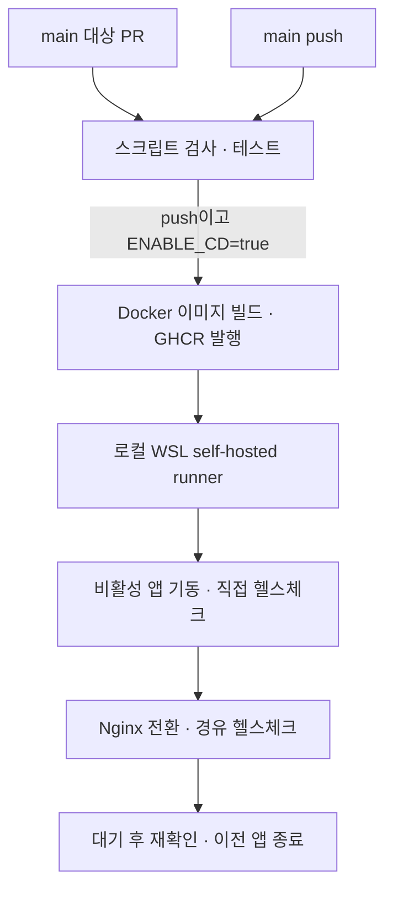

# GitHub Actions와 Nginx로 로컬 자동 배포·롤백 구성하기

코드를 이미지로 빌드하는 것과, 실행 중인 서비스를 새 버전으로 교체하는 것은 서로 다른 문제다. 이미지 빌드가 성공해도 애플리케이션이 정상적으로 시작되지 않거나, Nginx가 새 앱에 연결하지 못하면 배포는 끝난 것이 아니다.

이 프로젝트에서는 GitHub Actions로 테스트와 이미지 발행을 자동화하고, 로컬 WSL의 self-hosted runner에서 Blue/Green 배포를 수행하도록 구성했다. 새 앱을 먼저 확인한 뒤 요청을 전환하고, 전환에 실패하면 기존 앱으로 돌아갈 수 있도록 하는 것이 핵심이다.

## 빌드는 GitHub에서, 배포는 로컬에서

테스트와 이미지 빌드는 GitHub runner에서 수행한다. 로컬 PC는 GHCR에 올라간 이미지를 받아 실행하고 Nginx의 요청 대상을 바꾼다. 배포 PC에서 소스를 다시 빌드하지 않아도 되고, 실행할 버전도 이미지 태그로 지정할 수 있다.



[CI/CD workflow](../../.github/workflows/ci-cd.yml)는 `test → build-push → deploy`를 `needs`로 연결한다. PR에서는 검사와 테스트까지만 실행하며, `main`에 push하고 저장소 변수 `ENABLE_CD`가 `true`일 때 이미지 발행과 배포로 이어진다.

로컬 배포 job은 다음 라벨을 모두 가진 runner에서 실행된다.

```yaml
runs-on: [self-hosted, linux, x64, ticketing-deploy]
```

여기서 self-hosted runner는 GitHub Actions의 작업을 내 PC에서 실행하는 프로그램이다. WSL Ubuntu에 runner를 등록하고 Docker Desktop과 연동하면, 해당 job의 Docker 명령이 로컬 컨테이너를 관리한다. 테스트와 빌드에는 `ubuntu-latest`를 사용하므로 두 실행 환경의 역할도 구분된다.

## 배포할 버전은 커밋 SHA로 정했다

`main` 같은 태그는 새 이미지가 발행될 때마다 가리키는 대상이 바뀐다. 배포와 롤백에서 버전을 지정하려면 어떤 커밋으로 만든 이미지인지 함께 남겨야 한다.

현재 workflow는 하나의 이미지에 두 태그를 붙인다.

```yaml
tags: |
  ${{ steps.image.outputs.name }}:main
  ${{ steps.image.outputs.ref }}
```

`image_ref`는 `ghcr.io/<owner>/<repository>:<전체 커밋 SHA>` 형식이다. `main` 태그는 최신 발행 이미지를 확인하는 용도로 두고, 실제 배포 job에는 해당 실행의 SHA 태그를 전달한다. 롤백할 때도 같은 형식으로 이전 버전을 선택한다.

## 캐시로 반복 빌드 시간을 줄였다

빌드 과정에서는 반복 작업을 줄이기 위해 캐시를 나눠 사용했다. 테스트 job은 `setup-java`의 Gradle 캐시를 사용하고, 이미지 빌드는 `cache-from/to: type=gha`로 BuildKit 캐시를 가져오고 내보낸다. [Dockerfile](../../Dockerfile)도 Gradle 설정을 먼저 복사한 뒤 의존성을 준비하고, 그다음 소스를 복사한다. 소스만 바뀐 경우 앞쪽 의존성 준비 레이어를 재사용할 수 있도록 한 것이다.

두 job의 캐시가 자동으로 공유되는 것은 아니다. Docker 빌드는 자체 builder 안에서 `bootJar`를 실행하며, 최종 이미지에는 JRE와 생성된 JAR를 담는다.

실제 효과는 [캐시 벤치마크 workflow](../../.github/workflows/cache-benchmark.yml)로 비교했다. 2026-10-20에 커밋 `c1615d3`를 대상으로 캐시 준비 실행 1회 후 동일 커밋에서 3회 반복했다. 아래는 캐시 복원과 후처리를 포함한 **job 전체 시간의 중앙값**이다.

| 측정 대상 | 캐시 미사용 | 캐시 사용 | 단축률 |
| --- | ---: | ---: | ---: |
| Gradle 테스트 job | 170초 | 95초 | **44.1%** |
| Docker 이미지 빌드 job | 105초 | 23초 | **78.1%** |

반복 실행은 모두 성공했으며, Gradle 로그에서 의존성·wrapper 캐시 복원을 확인했다. Docker도 의존성 준비와 `bootJar` 단계가 `CACHED`로 재사용됐다. 캐시를 처음 만드는 준비 실행은 위 비교에서 제외했다. [GitHub Actions 실행 기록](https://github.com/hankyu0301/ticketing/actions/runs/39347332750)

이 수치는 동일 소스 재빌드에서 확인한 효과다. 소스를 변경하면 `COPY src` 이후 단계가 다시 실행될 수 있으므로, 변경 후 빌드 시간은 별도로 비교할 항목이다. 벤치마크는 `push: false`로 실행해 이미지 발행과 로컬 배포 시간은 포함하지 않았다.

## 기존 앱을 먼저 내리지 않고 반대쪽에 새 앱을 띄운다

앱 하나를 중지하고 새 컨테이너를 올리면, 기동을 기다리는 동안 요청을 처리할 앱이 없어진다. 새 버전이 시작되지 않는다면 그 시간도 길어진다.

그래서 [Blue/Green Compose](../../docker-compose.bluegreen.yml)에 `app-blue`와 `app-green`을 두었다. 두 앱은 같은 MariaDB·Redis·RabbitMQ를 사용하고, Nginx가 현재 서비스할 앱 한쪽으로 요청을 전달한다.

| 경로 | 기본 주소 | 역할 |
| --- | --- | --- |
| Nginx | `127.0.0.1:18000` | 서비스 요청 경로 |
| Blue | `127.0.0.1:18080` | Blue 앱 직접 확인 |
| Green | `127.0.0.1:18081` | Green 앱 직접 확인 |

예를 들어 Blue가 서비스 중이면 Green에 새 이미지를 올린다. Blue는 그대로 요청을 받으므로, Green의 기동과 상태 확인을 마칠 때까지 기존 서비스를 유지할 수 있다.

현재 색상은 단순히 실행 중인 컨테이너 이름으로 정하지 않는다. [배포 스크립트](../../infra/deploy/blue-green-deploy.sh)의 `active_color()`가 Nginx upstream 설정을 읽고, 그 설정이 가리키는 앱도 실행 중인지 확인한다. 전환 도중에는 두 앱이 함께 실행될 수 있기 때문에 **현재 요청을 받는 쪽**을 기준으로 판단하는 것이다.

최초 배포에는 기존 앱이 없으므로 MariaDB·Redis·RabbitMQ와 Blue를 먼저 올린다. Blue의 상태를 확인한 다음 Nginx를 시작하며, 이후 배포부터 반대 색상으로 교체한다.

## 앱 직접 확인과 Nginx 경유 확인을 나눴다

컨테이너가 실행 중이라는 사실만으로 서비스 요청이 정상 처리된다고 판단하기는 어렵다. 새 앱 자체가 응답하는지와, Nginx를 거쳐 그 앱에 도달하는지를 순서대로 확인한다.

1. 비활성 앱을 실행하고 해당 포트의 `/actuator/health`를 확인한다.
2. 기존 Nginx 설정을 백업한 뒤 upstream을 새 앱으로 바꾼다.
3. `nginx -t`로 설정을 검사하고 `nginx -s reload`로 반영한다.
4. Nginx를 경유하는 `18000/actuator/health`를 확인한다.
5. 기본 10초를 기다린 뒤 같은 경로를 다시 확인하고 이전 앱을 중지한다.

예를 들어 Green의 직접 헬스체크가 성공해도 upstream 이름이나 프록시 설정이 잘못되면 실제 요청 경로는 실패할 수 있다. 전환 이후 검사를 한 번 더 두는 이유다. Nginx 자체의 `/nginx-health`는 고정된 `200`을 반환하므로, 앱까지 확인하는 배포 검사에는 사용하지 않는다.

`check_url()`은 `curl --fail`로 HTTP 응답을 확인하며 최대 30회 재시도한다. Spring Security에서도 `/actuator/health`는 인증 없이 접근할 수 있도록 열어 두었다. 이 검사는 기동과 연결 상태를 확인하며, 예약·결제 같은 업무 시나리오 검증은 테스트 단계와 구분한다.

Nginx는 reload할 때 새 설정을 사용하는 worker를 만들고 기존 worker가 처리하던 연결을 마무리하도록 한다. 이 동작에 맞춰 앱도 전환 직후 바로 종료하지 않고 `DRAIN_SECONDS`만큼 유지했다. 현재 기본값 10초는 종료 전 대기 시간이며, 모든 요청의 완료를 추적한 값은 아니다. 긴 요청이 있는 환경에서는 요청 처리 시간과 앱 종료 설정을 함께 맞춰야 한다.

## 배포 실패 복구와 이전 버전 롤백

새 앱에 요청을 보내기 전에 실패했다면 기존 경로를 유지하면 된다. 반면 Nginx 설정을 바꾼 뒤 실패했다면 요청 경로부터 복구해야 한다.

| 실패 지점 | 스크립트의 처리 |
| --- | --- |
| 새 앱 기동·직접 헬스체크 | 새 앱을 중지하고 기존 앱과 요청 경로 유지 |
| Nginx 설정 검사·reload·전환 후 검사 | 백업 설정 복원 → reload → 기존 경로 응답 확인 → 새 앱 중지 |
| 기존 경로 복구 확인도 실패 | 앱과 백업을 보존하고 오류로 종료 |

`rollback_nginx()`는 설정 파일만 되돌리고 끝내지 않는다. 복원한 경로의 응답까지 확인한 뒤 백업을 정리한다. 복구에 실패해 `.bak` 파일이 남았다면 다음 배포도 중단하여, 새 작업이 복구 자료를 덮어쓰지 않도록 했다.

배포가 완료된 뒤 이전 앱 버전으로 돌아가려면 [Rollback workflow](../../.github/workflows/rollback.yml)를 수동 실행한다. `main` 브랜치를 선택하고, GHCR에 발행된 이미지의 소문자 40자리 커밋 SHA를 입력한다.

이때 이미지를 다시 빌드하지 않는다. 지정한 SHA의 이미지를 비활성 쪽에 띄우고, 자동 배포와 같은 스크립트로 확인·전환한다. 앱 버전은 과거 것을 선택하지만 배포 도구는 현재 `main`에서 가져오므로, 이전 이미지와 현재 설정의 호환성은 함께 확인해야 한다.

또한 앱 이미지를 되돌려도 DB 데이터는 그대로 유지된다. Blue와 Green이 같은 DB를 사용하는 만큼, 스키마를 변경할 때는 두 버전이 함께 동작할 수 있도록 컬럼 추가·데이터 이전·기존 구조 정리를 나누는 방식이 필요하다.

## 배포 중 바뀌면 안 되는 상태는 checkout 밖에 둔다

runner의 checkout 폴더는 다음 작업에서 다시 준비되는 공간이다. 이곳을 Nginx 설정의 마운트 경로로 사용하면 checkout 정리와 실행 중인 서비스의 설정이 얽힐 수 있다.

배포 스크립트는 Compose·스키마 파일·Nginx 설정을 기본 `$HOME/ticketing-deploy`에 복사한다. 특히 Nginx 설정에는 현재 활성 색상이 남으므로, 소스와 별도로 유지해야 다음 배포에서도 전환 대상을 판단할 수 있다. 경로 검사도 runner 홈 아래이면서 checkout과 겹치지 않는 위치만 허용한다.

실행 환경은 `ticketing-local`이라는 Compose 프로젝트로 구분했다. MariaDB와 RabbitMQ는 각각 `ticketing-local_mariadb-data`, `ticketing-local_rabbitmq-data` 볼륨을 사용한다. 일반적인 앱 교체에서는 이 컨테이너들을 다시 올리지 않고 비활성 앱만 기동한다. `schema.sql`은 새 DB 초기화에 사용하며, 기존 DB의 변경은 별도 마이그레이션으로 다뤄야 한다.

배포끼리 겹치는 문제도 두 위치에서 막는다. GitHub Actions에서는 자동 배포와 롤백이 같은 `cd-local` concurrency 그룹을 사용하고, 실행 중인 배포를 취소하지 않도록 `cancel-in-progress: false`로 둔다. 스크립트에서는 배포 폴더의 `.deploy.lock`에 `flock -n`을 적용해 직접 실행한 배포와의 충돌도 차단한다.

## 로컬에서 실행하기 위한 설정

Docker Desktop의 Ubuntu WSL 연동을 켜고, Ubuntu에서 `docker version`, `docker compose version`, `command -v curl flock`이 정상인지 확인한다. 이후 저장소의 **Settings → Actions → Runners**에서 Linux·x64 runner를 등록하고 `ticketing-deploy` 라벨을 추가한다.

runner 폴더에서 `./run.sh`를 실행해 작업을 기다리게 하고, 저장소 Actions 변수에 `ENABLE_CD=true`를 등록한다. 배포 중에는 WSL·Docker·runner가 실행 중이어야 한다.

| 저장소 변수 | 기본값 | 용도 |
| --- | --- | --- |
| `LOCAL_DEPLOY_DIR` | `$HOME/ticketing-deploy` | 배포 파일·Nginx 상태 보관 |
| `LOCAL_DEPLOY_PORT` | `18000` | Nginx 접속 포트 |
| `BLUE_PORT` · `GREEN_PORT` | `18080` · `18081` | 앱 직접 확인 포트 |
| `APP_HEALTH_PATH` | `/actuator/health` | 배포 확인 경로 |
| `ACTIVE_APP_DRAIN_SECONDS` | `10` | 전환 후 이전 앱 종료 전 대기 |

GHCR 로그인에는 `GITHUB_TOKEN`을 사용한다. 이미지 발행 job에는 `packages: write`, 배포·롤백에는 `packages: read`를 부여했다. 로컬 runner의 로그인 정보는 작업별 임시 Docker 설정 폴더에 저장하고 종료 시 정리한다.

기본 설정에서 상태와 로그는 다음과 같이 확인한다.

```bash
cd "$HOME/ticketing-deploy"

APP_DIR="$PWD" docker compose --project-name ticketing-local \
  -f docker-compose.bluegreen.yml ps -a

APP_DIR="$PWD" docker compose --project-name ticketing-local \
  -f docker-compose.bluegreen.yml logs --tail=100 nginx app-blue app-green

curl --fail http://127.0.0.1:18000/actuator/health
```
