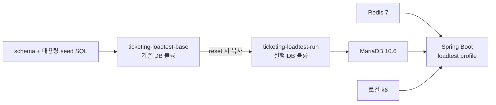

# k6 Queue / Reservation Load Test

이 디렉터리는 대기열 진입·순번 조회, active token, 예약 생성 처리량, 인기 좌석 경합을 재현 가능한 조건으로 검증하기 위한 k6 부하테스트 환경입니다.

일반 시나리오는 BCrypt 로그인 비용을 측정 구간에서 제외하기 위해 `loadtest` 프로필 전용 세션 API를 사용합니다. `smoke-seeded-login`만 실제 로그인 API를 호출해 인증 흐름 자체를 확인합니다.

## 측정 범위

- Redis waiting/active 대기열의 진입량과 순번 조회 비용
- 고유 좌석 예약의 처리량과 tail latency
- 단일 좌석 burst 및 인기 좌석군 경합의 성공·비즈니스 실패·빠른 실패 분리
- 중복 예약, dropped iteration, 예상 밖 응답, MariaDB slow query
- 애플리케이션 내부의 queue 검증·락·DB 구간별 timer

결제와 RabbitMQ 처리량은 이 환경의 측정 대상이 아닙니다. loadtest 애플리케이션에서는 RabbitMQ listener와 동적 리소스 생성을 비활성화합니다.

## 사전 준비

- Java 17
- Docker Engine 또는 Docker Desktop과 Docker Compose v2
- 로컬에 설치된 k6
- 사용 가능한 호스트 포트: `8080`, `3306`, `6379`

다음 명령이 모두 동작하는지 먼저 확인합니다.

```bash
java -version
docker compose version
k6 version
```

모든 Gradle 명령은 저장소 루트에서 실행합니다. 기본 HA Compose나 standalone Compose와 포트가 겹치므로 동시에 실행하지 않습니다.

## 환경 구성



| 구성요소 | 역할 |
| --- | --- |
| `ticketing-loadtest-base` | schema와 대용량 seed가 적용된 재사용 기준 DB 볼륨 |
| `ticketing-loadtest-run` | 각 테스트 전에 base에서 복사하는 변경 가능한 DB 볼륨 |
| `ticketing-loadtest-mariadb` | 실제 시나리오가 사용하는 MariaDB |
| `ticketing-loadtest-redis` | Spring Session, queue, 예약 불가 캐시, 분산락 저장소 |
| `ticketing-loadtest-app` | `loadtest` 프로필로 실행되는 Spring Boot 애플리케이션 |

구성의 기준 파일은 [docker-compose.loadtest.yml](../docker-compose.loadtest.yml)입니다.

## Seed 데이터

[10_seed_large_base.sql](./fixtures/mysql/10_seed_large_base.sql)은 `INSERT ... SELECT` 방식으로 다음 데이터를 생성합니다.

| 데이터 | 수량 |
| --- | ---: |
| 회원 | 100,000명 |
| hot schedule 좌석 | 50,000석 |
| history schedule 좌석 | 50,000석 |
| 예약 이력 | 300,000건 |
| 결제 이력 | 240,000건 |

seed 회원의 비밀번호는 모두 `password1234!`입니다. 실제 BCrypt 로그인은 `smoke-seeded-login`에서만 사용합니다.

## 최초 실행

1. loadtest 애플리케이션 이미지를 빌드합니다.

```bash
bash ./gradlew loadtestAppBuild
```

2. 기준 DB 볼륨을 생성합니다. 기존 `ticketing-loadtest-base` 볼륨은 삭제 후 재생성되므로 seed SQL이나 schema가 바뀐 경우에만 다시 실행합니다.

```bash
bash ./gradlew loadtestBaseRebuild
```

3. 대용량 seed 초기화가 끝나 `healthy` 상태가 될 때까지 확인합니다. 초기 생성에는 시간이 걸릴 수 있습니다.

```bash
docker compose -f docker-compose.loadtest.yml --profile base ps mariadb-base
```

4. 기준 DB를 run DB로 복사하고 MariaDB, Redis, 애플리케이션을 실행합니다.

```bash
bash ./gradlew loadtestRunReset
```

`loadtestRunReset`은 기존 run DB 내용을 지우고 base DB 상태로 교체합니다. 보존해야 할 측정 데이터가 있다면 먼저 결과를 기록합니다.

5. 컨테이너 상태와 seed 건수를 확인합니다.

```bash
docker compose -f docker-compose.loadtest.yml ps
bash ./gradlew loadtestVerifyLargeSeed
curl --fail http://localhost:8080/actuator/health
```

6. 실제 로그인 smoke를 실행합니다.

```bash
bash ./gradlew loadtestRunK6 \
  -Pscenario=smoke-seeded-login \
  -Ptargets=loadtest/k6/data/targets.smoke.json \
  -Pprofile=smoke
```

## 반복 실행 흐름

동일한 기준 데이터에서 테스트를 반복할 때는 base DB를 다시 만들지 않습니다.

1. 완전히 동일한 DB 상태가 필요하면 `loadtestRunReset`을 실행합니다.
2. 예약 시나리오만 반복하면 `loadtestResetHotSchedule`로 hot schedule을 초기화합니다.
3. 대기열 상태는 `loadtestResetRedisQueue` 후 필요한 active/waiting 사용자를 다시 seed합니다.
4. slow query를 비교한다면 각 실행 직전에 `loadtestResetSlowLog`를 실행합니다.
5. k6 실행 후 결과 파일, DB 정합성, slow query, 내부 timer를 함께 기록합니다.

## Loadtest 전용 세션

`loadtest` 프로필에서만 다음 API가 등록됩니다.

```http
POST /api/v1/loadtest/sessions
Content-Type: application/json

{
  "email": "loadtest-user-020001@test.com"
}
```

이 API는 seed 회원을 조회해 BCrypt 검증 없이 Spring Security `SESSION`과 CSRF 흐름을 준비합니다. 운영 프로필에서는 컨트롤러와 전용 Security 설정이 활성화되지 않습니다.

## 시나리오

| 시나리오 | executor | 인증 준비 | 주요 판정 |
| --- | --- | --- | --- |
| `smoke-seeded-login` | `per-vu-iterations` | 실제 로그인 API | 인증 실패 `0`, HTTP 오류 확인 |
| `load-queue-enter` | `constant-arrival-rate` | loadtest 세션 | entered/waiting 비율, retryAfter, 예상 밖 실패 |
| `load-queue-rank-polling` | `constant-arrival-rate` | loadtest 세션 | rank, retryAfter, active 전환 시간 |
| `load-reservation-unique` | 기본 `shared-iterations` | setup에서 VU별 세션 선발급 | 모든 요청 `201`, 예약 p95, 예상 밖 실패 `0` |
| `stress-reservation-contention` | `constant-arrival-rate` | VU별 loadtest 세션 재사용 | `201`·`400`·`429` 분리, 중복 예약 `0` |
| `burst-reservation-contention` | `per-vu-iterations` | setup에서 VU별 세션 선발급 | 단일/좁은 좌석군 순간 경합과 lock wait |

경합 시나리오에서 `400`은 이미 점유되거나 판매된 좌석의 정상적인 비즈니스 실패이고, `429`는 lock wait timeout에 따른 빠른 실패입니다. 두 응답을 시스템 오류와 분리해 해석합니다.

## 주요 실행 예시

### Queue enter

```bash
bash ./gradlew loadtestResetRedisQueue
bash ./gradlew loadtestSeedRedisQueue -PactiveCount=0 -PwaitingCount=0
bash ./gradlew loadtestRunK6 \
  -Pscenario=load-queue-enter \
  -Ptargets=loadtest/k6/data/targets.large.json \
  -Pprofile=baseline
```

### Queue rank polling

```bash
bash ./gradlew loadtestResetRedisQueue
bash ./gradlew loadtestSeedRedisQueue \
  -PactiveStartMemberId=1 -PactiveCount=1000 \
  -PwaitingStartMemberId=1001 -PwaitingCount=19000
bash ./gradlew loadtestRunK6 \
  -Pscenario=load-queue-rank-polling \
  -Ptargets=loadtest/k6/data/targets.large.json \
  -Pprofile=baseline
```

`POLL_UNTIL_ACTIVE=true` 환경변수를 추가하면 단순 rank 조회 대신 active 전환까지 polling합니다.

### 고유 좌석 예약

```bash
bash ./gradlew loadtestResetHotSchedule
bash ./gradlew loadtestResetRedisQueue
bash ./gradlew loadtestSeedRedisQueue \
  -PactiveStartMemberId=20001 -PactiveCount=10000 -PwaitingCount=0
bash ./gradlew loadtestRunK6 \
  -Pscenario=load-reservation-unique \
  -Ptargets=loadtest/k6/data/targets.large.json \
  -Pprofile=baseline
```

고정 요청률을 비교할 때는 executor를 함께 변경합니다. 예시는 300 iterations/s를 10초 동안 생성하는 설정입니다.

```bash
bash ./gradlew loadtestRunK6 \
  -Pscenario=load-reservation-unique \
  -Ptargets=loadtest/k6/data/targets.large.json \
  -Pprofile=rps300 \
  -PreservationExecutor=constant-arrival-rate
```

### 인기 좌석군 경합

최종 검증에 사용한 `targets.contention-500.json`은 500석을 `front 50석 / middle 150석 / normal 300석`으로 나누고 요청 비중을 `60 / 30 / 10`으로 적용합니다. 좌석 선택은 iteration index 기반이므로 같은 설정에서 같은 분포를 재현합니다.

```bash
bash ./gradlew loadtestResetHotSchedule
bash ./gradlew loadtestResetRedisQueue
bash ./gradlew loadtestSeedRedisQueue \
  -PactiveStartMemberId=30001 -PactiveCount=2000 -PwaitingCount=0
bash ./gradlew loadtestResetSlowLog -PlongQueryTime=0.05
bash ./gradlew loadtestRunK6 \
  -Pscenario=stress-reservation-contention \
  -Ptargets=loadtest/k6/data/targets.contention-500.json \
  -Pprofile=baseline
```

### Active admission 비교

active 사용자 수와 k6 VU 상한을 함께 바꿔 비교합니다. 각 조건을 실행하기 전에 hot schedule과 Redis queue를 다시 초기화해야 합니다.

```bash
bash ./gradlew loadtestResetHotSchedule
bash ./gradlew loadtestResetRedisQueue
bash ./gradlew loadtestSeedRedisQueue \
  -PactiveStartMemberId=30001 -PactiveCount=500 -PwaitingCount=0
bash ./gradlew loadtestRunK6 \
  -Pscenario=stress-reservation-contention \
  -Ptargets=loadtest/k6/data/targets.contention-500.json \
  -Pprofile=baseline \
  -PpreAllocatedVus=500 -PmaxVus=500
```

### 단일 좌석 burst

`targets.burst-contention.json`의 `reservation.burstSeats.count` 기본값은 `1`입니다. VU마다 한 번씩 같은 좌석에 요청하므로 최초 경합 지연과 빠른 실패 분포를 확인할 수 있습니다.

```bash
bash ./gradlew loadtestResetHotSchedule
bash ./gradlew loadtestResetRedisQueue
bash ./gradlew loadtestSeedRedisQueue \
  -PactiveStartMemberId=40001 -PactiveCount=500 -PwaitingCount=0
bash ./gradlew loadtestRunK6 \
  -Pscenario=burst-reservation-contention \
  -Ptargets=loadtest/k6/data/targets.burst-contention.json \
  -Pprofile=burst300
```

## Target과 profile 선택

| target 파일 | 용도 |
| --- | --- |
| [targets.smoke.json](./k6/data/targets.smoke.json) | 최소 데이터 범위의 빠른 동작 확인 |
| [targets.large.json](./k6/data/targets.large.json) | queue, 고유 좌석 예약, RPS별·stress profile |
| [targets.contention-100.json](./k6/data/targets.contention-100.json) | 인기 좌석 100석 경합 |
| [targets.contention-500.json](./k6/data/targets.contention-500.json) | 최종 검증 기준인 인기 좌석 500석 경합 |
| [targets.contention-2000.json](./k6/data/targets.contention-2000.json) | 인기 좌석 2,000석 경합 |
| [targets.burst-contention.json](./k6/data/targets.burst-contention.json) | 단일 또는 좁은 좌석군 burst |

사용 가능한 profile은 target JSON마다 다릅니다. 예를 들어 `baseline`, `stress`, `rps100`, `rps300`, `rps500`, `rps500Long`, `burst300`, `burst500`이 모두 한 파일에 정의된 것은 아닙니다. 선택한 target에 profile/시나리오 조합이 없으면 코드의 시나리오 기본값으로 실행되므로, 측정 전에 JSON 설정과 k6 시작 로그를 확인합니다.

## 설정 override

`loadtestRunK6`는 다음 Gradle property를 k6 환경변수로 전달합니다.

| Gradle property | 의미 |
| --- | --- |
| `-Pscenario` | 실행할 시나리오 이름 |
| `-Ptargets` | target JSON의 저장소 상대 경로 |
| `-Pprofile` | target JSON 안에서 선택할 profile |
| `-Presult` | 결과 파일 경로 prefix |
| `-Prate`, `-Pduration` | constant-arrival-rate 요청률과 지속 시간 |
| `-Pvus`, `-Piterations` | shared/per-VU iterations의 VU와 반복 수 |
| `-PpreAllocatedVus`, `-PmaxVus` | constant-arrival-rate VU 범위 |
| `-PmaxDuration` | iterations executor의 최대 실행 시간 |
| `-PreservationExecutor` | 고유 좌석 예약 executor: `shared-iterations` 또는 `constant-arrival-rate` |

고급 동작은 셸 환경변수로 전달할 수 있습니다.

- `POLL_UNTIL_ACTIVE=true`: rank polling을 active 전환까지 반복
- `ENABLE_ACTIVE_LEAVE=true`: 고유 좌석 예약 후 active slot 반납
- `BASE_URL=http://host:port`: target JSON의 base URL override
- `NO_COOKIES_RESET=false`: k6 iteration 사이 cookie 초기화 허용

## 결과와 정합성 확인

결과는 기본적으로 다음 파일에 생성됩니다.

```text
loadtest/k6/results/{scenario}-summary.json
loadtest/k6/results/{scenario}-summary.txt
```

`loadtest/k6/results/`는 `.gitignore` 대상입니다. 비교에 사용할 실행 조건과 핵심 수치는 [성능 문서](../docs/performance)에 Markdown으로 정리하고, 원본 결과는 필요에 따라 별도로 보관합니다.

결과 해석 시 다음 지표를 함께 확인합니다.

- `reservation_unexpected_failure_rate`: 경합에서 허용한 `201/400/429` 이외의 실패
- `reservation_business_failure_rate`: 이미 점유된 좌석의 정상 경쟁 실패 비율
- `reservation_lock_timeout_rate`: lock wait timeout으로 빠르게 거절된 비율
- `dropped_iterations`: k6가 설정한 요청률을 만들지 못한 횟수
- `reservation_duration_ms`: 예약 전체 지연의 avg, p95, p99

경합 테스트 후 DB 상태와 중복 예약을 확인합니다.

```sql
SELECT status, COUNT(*)
FROM seats
WHERE schedule_id = 1
GROUP BY status;

SELECT status, COUNT(*)
FROM reservations
WHERE schedule_id = 1
GROUP BY status;

SELECT seat_id, COUNT(*) AS reservation_count
FROM reservations
WHERE schedule_id = 1
GROUP BY seat_id
HAVING COUNT(*) > 1;
```

slow query와 주요 예약 SQL 실행 계획은 Gradle task로 확인합니다.

```bash
bash ./gradlew loadtestDumpSlowLog -PslowLogLimit=20
bash ./gradlew loadtestExplainReservationQueries \
  -PseatId=10001 -PmemberId=30001 -PreservationId=1 -PprocessLimit=300
```

애플리케이션 내부 구간별 timer는 loadtest 전용 endpoint에서 확인합니다.

```bash
curl --fail http://localhost:8080/api/v1/loadtest/metrics/timers
```

2026년 6월 성능 문서의 `ticketing.loadtest.db.seat.update`는 당시 `SeatMapper.update`를 측정한 값입니다. 이후 기본 예약 경로가 사용하는 `reserveIfAvailable` 조건부 갱신은 현재 AOP에서 별도 timer로 분리되지 않으며 `reservation.service` 구간에 포함됩니다. 현재 DB 갱신 비용은 slow log와 실행 계획을 함께 확인합니다.

서로 다른 PC, Docker 자원, target, profile의 결과를 절대 처리량으로 직접 비교하지 않습니다. target·profile·override·코드 SHA와 테스트 시간을 결과 문서에 함께 기록합니다.

## 종료와 문제 확인

실행 중인 loadtest 컨테이너를 종료하되 base/run named volume은 유지합니다.

```bash
bash ./gradlew loadtestRunDown
```

상태나 기동 실패 원인은 다음 명령으로 확인합니다.

```bash
docker compose -f docker-compose.loadtest.yml ps
docker compose -f docker-compose.loadtest.yml logs --tail=200 app mariadb redis
```

`loadtestRunReset` 전에 base volume이 존재해야 합니다. schema 또는 seed SQL이 변경된 경우에는 `loadtestBaseRebuild`부터 다시 실행합니다.

## 관련 성능 문서

- [예약 시스템 부하테스트 및 성능 개선 요약](../docs/performance/reservation-loadtest-performance-report.md)
- [인기 좌석군 경합 부하테스트 결과](../docs/performance/stress-reservation-popular-contention-result.md)
- [예약 좌석 경합 병목 탐색 결과](../docs/performance/reservation-contention-bottleneck-analysis.md)
- [예약 빠른 실패 및 lock wait 튜닝 결과](../docs/performance/reservation-fast-fail-loadtest-result.md)
- [Active 사용자 수별 admission 기준](../docs/performance/active-admission-loadtest-result.md)
